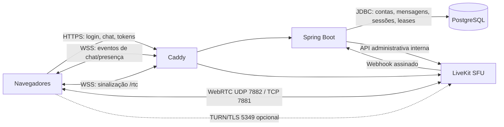
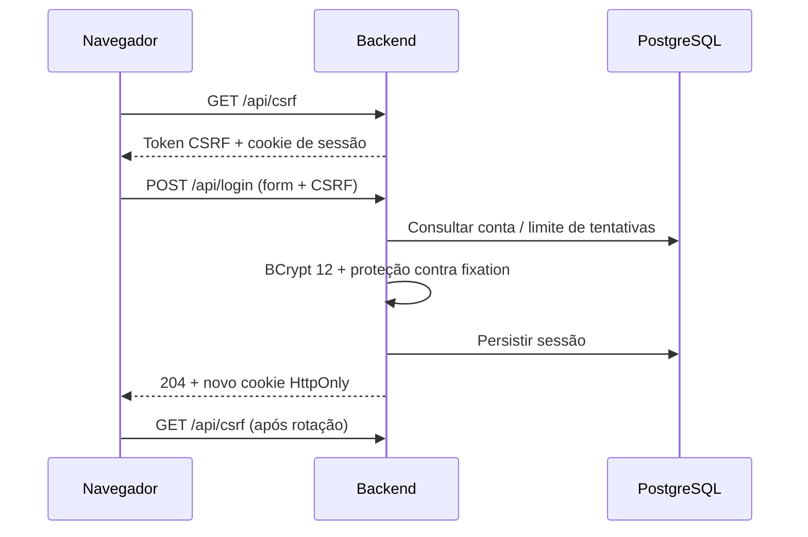
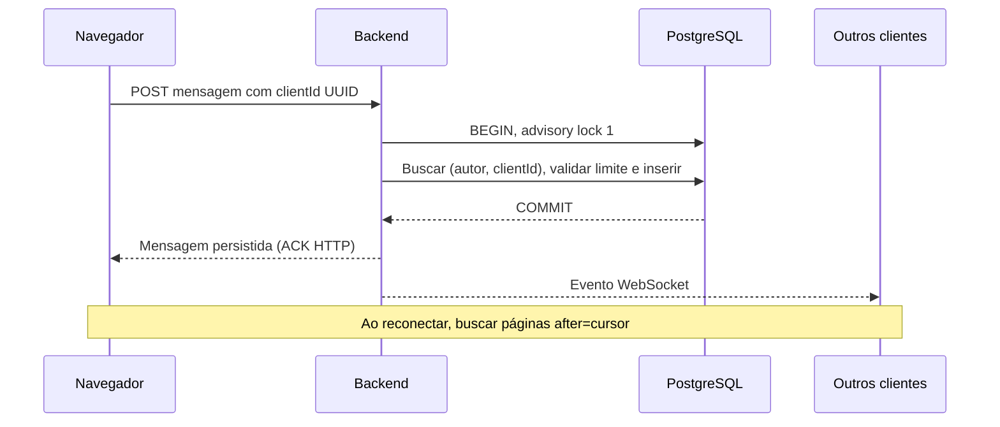

# Arquitetura

Monólito modular Java, banco único e SFU. Não há Redis, transcoding, agentes, ingress/egress ou gravação. A SFU encaminha mídia; HTTP/WebSocket transportam controle e chat.



## Identidade



## Mensagem



O lock serializa alocação/commit dos IDs do canal único, evitando que uma mensagem com ID menor faça commit depois de outra já entregue ao cursor. Erro na entrega WebSocket não desfaz persistência. Repetir mesmo UUID/corpo devolve a mesma mensagem; mesmo UUID com outro corpo dá 409.

## Voz e tela

```mermaid
sequenceDiagram
 participant U as Navegador
 participant B as Backend
 participant P as PostgreSQL
 participant L as LiveKit
 U->>B: POST /media/join com sessão + CSRF
 B->>P: Registrar identidade única por aba/sessão
 B-->>U: JWT 90 s, sala fixa, somente microfone
 U->>B: Admissão da sinalização via Caddy
 B->>B: Verificar sessão e substituir JWT por grant de microfone
 U->>L: Conectar via proxy com JWT restrito
 U->>U: Pedir captura de tela na ação do usuário
 U->>B: POST /media/screen
 B->>P: BEGIN + advisory lock 2; reconciliar leases
 B->>L: Revogar reservas inválidas antes de reutilizar vagas
 B->>P: Reservar vaga livre (máximo 3), UUID / expiração 30 s
 B->>L: Habilitar screen_share e screen_share_audio
 B->>P: COMMIT
 B-->>U: Lease
 U->>L: Publicar tela
 U->>B: Heartbeat a cada 10 s
 U->>B: DELETE /media/screen com leaseId
 B->>L: Revogar fontes de tela
 B->>P: Limpar lease
```

Reconciliação a cada 3 s, também acionada por webhook assinado. Eventos duplicados/fora de ordem são gatilhos: consultamos estado atual na SFU, não reaplicamos cegamente eventos antigos. Se LiveKit não responde, novas reservas falham com 503. Lease persistente permite recuperar reinício. Conexões precisam heartbeat em 45 s e sessão válida. Página precisa ping WebSocket; é removida da presença em até 45 s, com verificação a cada 10 s.

Não há transação distribuída PostgreSQL/LiveKit. Concessão externa seguida de falha de commit pode deixar permissão órfã por alguns segundos; reconciliador a remove. JWTs renovados pela SFU podem carregar permissões elevadas; a admissão de sinalização os substitui por grants só de microfone. [SECURITY](SECURITY.md) registra as fronteiras desse controle. Não confundir o limite de três leases autorizadas com garantia adversarial de três tracks em cada instante.

Modelo: accounts → messages; accounts → media_connections → session_id; screen_lease tem três vagas fixas e identidade única entre as vagas ocupadas. Sessões JDBC persistem no PostgreSQL. Senhas não são recuperáveis. Backup inclui contas, histórico, esquema; restauração apaga sessões/conexões/leases por segurança.

## Separação operacional

`migrate` é um job de manutenção com credenciais próprias; o backend permanente usa apenas DML e Flyway desativado. Redes: `database_net` (db/backend/migrador, interna), `api_net` (web/edge/backend, interna), `control_net` (backend/SFU/bot de música, interna), `signal_net` (web/edge/SFU, interna), `ingress_net` e `media_net` (entrada/saída necessária; o bot de música usa `media_net` para mídia e para buscar no YouTube). Backend não tem ponte externa. Isso limita acesso lateral entre serviços; o bloqueio de conexões iniciadas para a LAN depende do host/firewall e precisa ser validado no OrbStack.

Veja [atualização de segurança](SECURITY_UPGRADE.md) para MFA, limites, arquivos privados e recuperação. O banco de integração `friends_test` usa `friends_tests`, sem credenciais de runtime/DBA entregues ao Maven.


O entrypoint da SFU lê a rota IPv4 padrão do contêiner e restringe `rtc.interfaces.includes` à interface de `media_net`, que recebe as portas publicadas. O nome `ethN` não é fixado: a seleção acompanha a rota real. A configuração montada permanece RO; a cópia temporária tem modo 0600. Isso evita que interfaces de sinalização/controle, anunciadas com o mesmo `node_ip`, sejam escolhidas após a deduplicação de candidatos ICE. `runtime-security.py` confirma o socket UDP na rede correta, e Playwright exige respostas STUN autenticadas por UDP e TCP.
