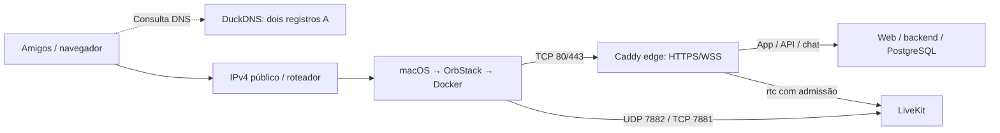

# DuckDNS com IPv4 público — plano de implementação

Data: **26/10/2026 (America/Sao_Paulo)**. Estado: **planejado, para execução futura**. Base: `dc4c012`. Este documento não registra domínios, altera roteador ou publica serviços.

## Decisão e premissas

Usar o perfil existente **`CHAT_MODE=internet`**, dois nomes gratuitos DuckDNS, certificados públicos gerenciados pelo Caddy e mídia LiveKit diretamente pelo IPv4 público do servidor. Amigos acessam pelo navegador, sem cliente VPN.

O proprietário confirmou que o IPv4 WAN do roteador coincide com o observado externamente e pertence à faixa pública `177.x.x.x`. Isso indica IPv4 público no roteador; **entrada TCP/UDP, firewall, bloqueios do provedor e encaminhamento pelo OrbStack ainda precisam ser testados**. Não registrar o endereço residencial real neste documento.

O DNS publicará o IP residencial. Login e permissões do aplicativo continuam obrigatórios; possuir o endereço não concede uma conta. DuckDNS resolve o nome, Caddy resolve HTTPS e o encaminhamento do roteador permite alcançar os serviços. São três tarefas distintas.

Premissas: Mac com OrbStack, acesso ao painel do roteador, reserva DHCP para o Mac, upload suficiente, conta DuckDNS e disponibilidade dos dois nomes. Confirmar condições atuais do serviço antes da implementação. Não comprar domínio, criar recursos pagos ou contratar IP como etapa automática.

## Arquitetura



Manter dois nomes diferentes, por exemplo `NOME-APP.duckdns.org` e `NOME-MIDIA.duckdns.org`, ambos apontando ao mesmo IPv4. Os nomes são exemplos a escolher no painel, não reservas existentes.

O Caddy atual possui dois blocos de site. **Não preencher APP_DOMAIN e MEDIA_DOMAIN com o mesmo nome**: unificar os domínios exigiria outra configuração. Dois nomes reaproveitam o desenho existente. A sinalização também passa pelo Caddy no domínio do aplicativo, mas a URL fornecida ao SDK neste plano será a do domínio de mídia.

Não publicar AAAA durante o piloto IPv4; verificar e remover eventual registro IPv6 antigo no serviço antes do teste. Não alterar a configuração global de IPv6 do Mac por causa disso. Não incluir TURN na primeira implementação; redes que bloqueiam UDP 7882 e TCP 7881 podem precisar de uma solução adicional, a avaliar depois.

## Portas e rede doméstica

Reservar o IPv4 LAN do Mac no DHCP do roteador. Preferir Ethernet. Se usar Wi-Fi, manter uma identidade MAC estável para a reserva, por exemplo endereço Wi-Fi privado fixo quando disponível. Private Relay e Limitar Rastreamento não precisam ser desativados permanentemente; a descoberta do IPv4 do servidor deve evitar medir uma saída de VPN/proxy diferente da WAN.

| Porta externa → mesma porta no Mac | Uso | Etapa |
|---|---|---|
| TCP 80 | ACME HTTP e redirecionamento para HTTPS | Encaminhar e testar |
| TCP 443 | HTTPS/WSS app e sinalização | Encaminhar e testar |
| UDP 7882 | Mídia ICE principal | Encaminhar e testar tráfego real |
| TCP 7881 | Fallback ICE | Encaminhar e testar tráfego real |
| UDP 443 | HTTP/3 opcional, não mídia LiveKit | Dispensável para o primeiro piloto |
| TCP 7880, 8080, 5432, 22 | Administração, HTTP interno, banco e SSH | **Não encaminhar** |

Não usar DMZ no roteador, UPnP como mecanismo de abertura automática ou desativação global do firewall. Permitir somente os fluxos/processos necessários no macOS. O caminho a comprovar é **internet → roteador → macOS → VM OrbStack → porta Docker publicada**. Rede host dentro de uma VM não equivale ao host macOS.

O teste externo deve ocorrer com celular em dados móveis ou outra conexão, com o Wi-Fi desligado. Acesso local pode depender de NAT loopback/hairpin do roteador; seu resultado não comprova acesso externo. Para uso na LAN, primeiro testar hairpin. Se não funcionar, planejar DNS local dos dois nomes apontando ao IP LAN do Mac, mantendo o mesmo HTTPS; testar também a mídia anunciada pelo LiveKit. Não recomendar HTTP por IP privado como solução para captura de tela/microfone.

## Trabalho no repositório

Reaproveitar `infra/compose/internet.yml`, `Caddyfile.internet`, backend, contas e admissão de mídia. Preservar os perfis local e Tailscale; nenhum deles será executado em paralelo sobre a mesma stack.

| Arquivo previsto | Mudança |
|---|---|
| `scripts/duckdns-init.sh` | Assistente de configuração: nomes, email ACME e arquivo privado do token; validações antes de alterar `.env`; preservar credenciais existentes |
| `scripts/duckdns-update.sh` | Orquestração no host: lock, descoberta/validação do IPv4, atualização DNS e aplicação coordenada do IP LiveKit; sem builds a cada execução |
| `scripts/duckdns-update.mjs` | Requisições HTTPS ao provedor, respostas verificadas e saída sanitizada; lê token de arquivo, não de argumento de linha de comando |
| `scripts/install-duckdns-launchagent.sh` | Instalação/remover LaunchAgent do usuário, executando o atualizador a cada cinco minutos, inicialmente; validar frequência permitida pelo provedor |
| `infra/macos/duckdns.plist.example` | Modelo com caminhos absolutos/escapados e token fora do plist; não depender do PATH do terminal |
| `scripts/render-config.mjs` | No modo internet, validar IPv4 global, domínios distintos, HTTPS/WSS exatos, email e rejeição de configuração herdada de Tailscale |
| `.env.example` / `.gitignore` | Documentar parâmetros não secretos; ignorar token, estado DDNS, locks e logs locais |
| `scripts/diagnose-duckdns.sh` | DNS A/AAAA, origem/IP anunciado, validade HTTPS e saúde da stack; sem dump de `.env` ou token |
| `scripts/tests/` e CI | Testes do atualizador/recuperação com endpoints simulados, validação Compose e segurança da sinalização |
| `docs/DUCKDNS_SETUP.md`, README, NETWORKING, OPERATIONS, TESTING, STATUS | Guia de ativação, operação, retorno ao perfil anterior e evidências reais |

Não criar outro `CHAT_MODE` apenas para DDNS. Os scripts DuckDNS selecionam explicitamente `internet`; `CHAT_MODE` é variável dos comandos e não será adicionado ao `.env` como se o wrapper o lesse dali.

### Configuração final esperada

Valores ilustrativos, a substituir por nomes registrados e pelo IPv4 real:

```dotenv
APP_DOMAIN=NOME-APP.duckdns.org
MEDIA_DOMAIN=NOME-MIDIA.duckdns.org
APP_ORIGIN=https://NOME-APP.duckdns.org
LIVEKIT_PUBLIC_URL=wss://NOME-MIDIA.duckdns.org
LIVEKIT_INTERNAL_URL=http://livekit:7880
COOKIE_SECURE=true
LIVEKIT_NODE_IP=IPV4_PUBLICO_REAL
ACME_EMAIL=EMAIL_REAL_DO_PROPRIETARIO
```

Nunca reusar o IP Tailscale, LAN ou localhost como candidato remoto deste perfil. Manter `use_external_ip: false` e `enable_loopback_candidate: false`. A restrição RTC a `tailscale0` pertence somente ao outro perfil e não pode permanecer no YAML gerado para internet.

### Token e agendamento

O token DuckDNS deve ser lido de arquivo privado, por exemplo `infra/compose/generated/duckdns/token`, com diretório 0700 e arquivo 0600. Não colocá-lo em `.env.example`, Git, plist, URL impressa ou argumentos de `curl`. Se a API exigir token na query string, construir a URL somente na memória do processo HTTPS e omiti-la de logs/erros. Não desativar TLS.

Confirmar o contrato vigente em `https://www.duckdns.org/spec.jsp`, incluindo atualização de ambos os nomes, seleção explícita de IPv4 e respostas de sucesso/erro. A API de atualização não deve ser tratada como API de registro de novos nomes. Registrar os nomes manualmente na conta antes do bootstrap.

Usar Node em container, seguindo o padrão do projeto; não exigir Node instalado no Mac. O script no host controla Docker. O processo de atualização dentro do container não receberá o socket Docker. Mount do token será somente leitura. O LaunchAgent deve localizar Docker por caminho absoluto, tratar OrbStack parado como falha recuperável e não abrir repetidamente janelas de login. Autostart antes de login do usuário não faz parte deste plano.

## Atualização coordenada do IP

**Trocar o registro DNS não atualiza o candidato ICE do LiveKit.** A implementação deve manter o mesmo IPv4 validado nos dois registros e em `LIVEKIT_NODE_IP`.

Fluxo previsto:

1. Obter lock no host para impedir concorrência com outra atualização/ativação. Não deixar um lock órfão bloquear indefinidamente após falha.
2. Descobrir IPv4 externo por HTTPS, validar formato e rejeitar faixas privadas, loopback, link-local, CGNAT e demais faixas não globais. Não aceitar uma resposta HTML, IPv6 ou um IP de saída de proxy como se fosse o IPv4 WAN confirmado.
3. Atualizar ambos os nomes com esse IPv4 explícito. Aplicar timeout e retry limitado com backoff; não imprimir a URL com token. Uma resposta HTTP 200 com corpo de erro é falha.
4. Verificar os registros A, distinguindo sucesso da API, estado autoritativo e caches de resolvedores. Tratar AAAA inesperado como configuração a corrigir. Aplicar timeout de propagação, sem prometer atualização instantânea para todos os clientes.
5. Se o IP já é o aplicado e a configuração está consistente, não reiniciar a SFU. Se mudou, atualizar `.env` e YAML com escrita segura, permissões restritas e preservação de segredos.
6. Recriar somente o serviço LiveKit com o perfil internet, sem dependências e sem rebuild. Confirmar saúde administrativa pela rede interna e manter o último estado aplicado somente após sucesso. Não alterar o banco ou reiniciar o backend/web sem necessidade.
7. Se DNS/configuração/recriação falhar, registrar estado sanitizado e deixar a execução seguinte tentar novamente. **Não declarar o novo IP aplicado nem suprimir retries porque o arquivo já mudou.** Manter cópia local da última configuração válida e documentar a recuperação.

Uma mudança real de IP interrompe chamadas; a automação restaura o serviço, não garante continuidade. É possível que alguns clientes usem o IP antigo até expirar o cache DNS. Não reiniciar repetidamente a SFU enquanto espera por caches.

## Sequência de implementação e ativação

1. **Preparação:** confirmar portas com o provedor quando necessário, disponibilidade dos nomes e suporte de encaminhamento no roteador/OrbStack. Medir upload cabeado. Executar backup verificável e guardar `.env` anterior com acesso restrito.
2. **Código e testes locais:** implementar inicialização, atualizador, lock, agendamento, validação e diagnóstico. Usar API simulada para testes; o CI não recebe token DuckDNS real.
3. **Registro e DNS:** proprietário registra os dois nomes e fornece token apenas por arquivo local. Executar o atualizador em modo de preparação, sem reiniciar uma stack em uso, e conferir os registros A.
4. **Rede:** reservar DHCP e configurar somente os encaminhamentos da tabela. Executar em janela sem chamadas. Parar o perfil anterior de forma explícita, preservando volumes. Se ele for Tailscale, desligar nó/consumidores antes de subir internet e revisar compartilhamentos que deixaram de ser necessários.
5. **Configuração:** gerar o modo internet com `CHAT_ALLOW_MODE_CHANGE=true` na troca inicial, usando as validações novas. Inspecionar `compose config -q`; não imprimir a configuração expandida. Confirmar que 7880/8080/5432 continuam sem publicação no host.
6. **HTTPS:** primeiro ensaiar emissão ACME no ambiente staging, com estado de certificados de teste separado; depois usar a CA pública de produção. Não compartilhar com amigos um certificado staging nem desativar verificação TLS. Evitar tentativas repetidas de produção ao diagnosticar DNS/portas.
7. **Validação externa:** testar app, sinalização e mídia a partir de duas redes externas; corrigir antes de instalar o agendamento permanente e convidar o restante do grupo.
8. **Agendamento e operação:** instalar LaunchAgent, exercitar mudança simulada de IP em ambiente isolado, verificar recuperação após OrbStack/rede indisponíveis e documentar como desativar o job.

Comandos finais de ativação devem ser publicados no futuro guia depois que os scripts existirem. Os nomes de scripts deste plano são entregas propostas, não comandos atualmente disponíveis.

## Testes e critérios de aceite

- Testes de configuração: dois domínios válidos/distintos; IPv4 público; origens HTTPS/WSS coerentes; cookie Secure; nenhum resquício de `tailscale0` no perfil internet. Preservar login, CSRF e validação de Origin.
- Testes do atualizador: IP inalterado sem restart; mudança atualiza os dois nomes e a SFU; erro do provedor, timeout, DNS atrasado, resposta inválida, token ausente e saída por IP não global. Verificar que stdout/stderr nunca contêm o token, inclusive nas exceções.
- Testes de recuperação: duas execuções simultâneas, processo interrompido, OrbStack parado, falha de recriação e retry após `.env` já alterado. Provar preservação das credenciais e do estado do banco.
- Reexecutar os oito testes existentes de browser/sinalização, lint/build e testes de configuração aplicáveis. `TEST_MEDIA_HOST` permite apontar o probe ICE ao IPv4 público enquanto `APP_TEST_URL` usa HTTPS. Processo de teste precisa estar na rede apropriada.
- De uma rede externa: certificado confiável para ambos os nomes, redirecionamento HTTP, chat realtime, duas conexões de áudio, permissão de microfone recusada, chegada/parada de tela e reconexão. Confirmar JWT elevado reduzido pela admissão e sessão expirada recusada.
- UDP 7882 precisa receber/responder ICE e entregar áudio/vídeo; um verificador de porta UDP genérico não prova isso. Testar TCP 7881 separadamente, usando restrição de UDP apenas no laboratório sob controle, sem burlar políticas gerenciadas do navegador.
- Confirmar que porta administrativa 7880, HTTP interno 8080, banco 5432 e SSH 22 não ficam acessíveis pela WAN. O domínio de mídia deve continuar encaminhando somente os caminhos de sinalização permitidos.
- Testar reinício do Mac/OrbStack, renovação ACME em staging e retorno do job depois de falha de rede. Preservar volumes de certificado. O HSTS já configurado no app requer HTTPS válido; rollback usa localhost/perfil anterior, não HTTP no mesmo domínio público.
- Medir 2/4/8/16 participantes por 20 minutos em cada carga aprovada, com cena em movimento e fala representativa. Registrar upload, CPU/RAM, RTT, perda, jitter, frames e quedas. Uma tela de 4 Mbit/s para 15 espectadores representa aproximadamente 60 Mbit/s de saída só de vídeo. Usar o preset reduzido se necessário e anunciar somente a carga medida.

Critério de conclusão: configuração reproduzível, atualização DNS/IP recuperável, HTTPS real, mídia bidirecional UDP e fallback TCP comprovados externamente, portas internas protegidas, recuperação/rollback exercitados e carga aprovada registrada. DNS funcionando ou página carregando não encerram o aceite de mídia.

## Operação e rollback

Manter Mac acordado e OrbStack ativo durante encontros. Acompanhar falhas do atualizador e validade dos certificados, sem publicar logs de URLs/token. Rotacionar token pela conta se necessário e atualizar somente o arquivo privado. Revisar o atualizador quando houver mudança de roteador, provedor ou interface de rede.

Para reverter: desativar/remover LaunchAgent; fechar encaminhamentos no roteador; parar a stack internet sem apagar volumes; restaurar `.env` anterior e regenerar/recriar o perfil local ou Tailscale em manutenção. Usar `CHAT_ALLOW_MODE_CHANGE=true` somente na troca deliberada. Confirmar dados e acesso no perfil restaurado. Não usar `down -v`.

Se encerrar o uso público, remover ou alterar os registros DuckDNS na conta e decidir a retenção do token. Não assumir que fechar o aplicativo remove os registros DNS ou que DNS antigo desaparece imediatamente de caches.

## Fontes para execução

- [DuckDNS — especificação da API](https://www.duckdns.org/spec.jsp) e [instruções oficiais](https://www.duckdns.org/install.jsp).
- [Caddy — HTTPS automático](https://caddyserver.com/docs/automatic-https).
- [Let's Encrypt — tipos de challenge](https://letsencrypt.org/docs/challenge-types/) e [staging](https://letsencrypt.org/docs/staging-environment/).
- [LiveKit — portas e firewall](https://docs.livekit.io/transport/self-hosting/ports-firewall/).
- Base local verificada: `infra/compose/internet.yml`, `infra/compose/Caddyfile.internet`, `scripts/render-config.mjs`, `scripts/up.sh` e [NETWORKING](NETWORKING.md).

Este plano foi elaborado a partir do código atual e do diagnóstico de IPv4 informado pelo proprietário. A disponibilidade comercial DuckDNS e os contratos das APIs devem ser conferidos na execução; não foram revalidados nesta etapa de planejamento. Nenhum teste externo no Mac foi realizado nesta etapa.
