# Entre amigos: guia para quem está começando a desenvolver

Este guia explica o projeto do primeiro acesso ao funcionamento interno. A leitura pressupõe noções básicas de programação, terminal e Git; Docker, Spring, WebSocket e WebRTC são apresentados conforme aparecem.

Referência: código e documentação disponíveis em **27/10/2026**. Os exemplos de comandos são instruções para estudo e execução consciente: ler este documento não inicia serviços nem altera o roteador. Para uma instalação existente, o procedimento de [atualização de segurança](SECURITY_UPGRADE.md) vem antes de qualquer tentativa de subir uma versão nova.

## Como usar este guia

| Seu objetivo | Comece por |
|---|---|
| Entender o produto e as tecnologias | [1. Produto](#1-o-que-o-projeto-faz) e [2. Conceitos](#2-conceitos-que-aparecem-no-projeto) |
| Encontrar os arquivos certos | [3. Arquitetura e pastas](#3-arquitetura-e-organização-das-pastas) |
| Executar no próprio computador | [4. Ambiente local](#4-primeira-execução-local) |
| Entender a interface e o login | [5. Frontend](#5-como-o-frontend-funciona) e [6. Backend e autenticação](#6-como-o-backend-recebe-e-autoriza-uma-requisição) |
| Entender dados e mensagens | [7. Banco](#7-banco-de-dados-e-migrações) e [8. Chat](#8-o-caminho-completo-de-uma-mensagem) |
| Entender voz, tela e volume | [9. Mídia](#9-voz-compartilhamento-de-tela-e-áudio) |
| Entender a instalação pública | [10. Internet e DuckDNS](#10-produção-internet-roteador-duckdns-e-https) |
| Alterar e validar código | [11. Testes](#11-testes-e-pipeline) e [14. Primeiro trabalho no código](#14-como-fazer-seu-primeiro-trabalho-no-código) |
| Operar, desligar ou recuperar | [12. Operação](#12-operação-parada-backup-e-recuperação) e [13. Segurança](#13-segurança-o-que-foi-protegido-e-o-que-ainda-depende-do-operador) |
| Consultar a documentação especializada | [15. Mapa de leitura](#15-mapa-da-documentação-e-próximos-estudos) |

Os diagramas usam **Mermaid**. O GitHub renderiza os blocos como figuras; em um editor local, pode ser necessário habilitar uma extensão de visualização Mermaid. O código dos diagramas permanece no Markdown para acompanhar as mudanças do projeto.

## 1. O que o projeto faz

**Entre amigos** é uma aplicação web privada para um grupo de pessoas convidadas. O repositório se chama `chat-friends`. Um administrador cria as contas; quem entra pode conversar por texto, participar de uma sala de voz e assistir a uma transmissão de tela.

O navegador é o cliente. O servidor guarda contas e mensagens, decide quem tem acesso e distribui áudio/vídeo. Não existe cadastro público ou recuperação de senha por e-mail.

### 1.1. Funcionalidades implementadas

| Área | Comportamento atual |
|---|---|
| Conta | Login, alteração de senha, perfis, foto, nome de exibição e nome de usuário |
| Administração | Criar contas, desativar/reativar pessoas e redefinir senhas |
| Segurança da conta | Autenticador TOTP, códigos de recuperação, consulta/revogação de sessões e reautenticação |
| Chat | Histórico persistente, confirmação de envio, recuperação após reconexão e proteção contra mensagens duplicadas |
| Voz | Microfone, seleção de entrada, ganho de microfone, supressão nativa de ruído e volumes pessoais |
| Tela | Reserva de transmissão, até Full HD/60 fps conforme os tetos configurados, player expandido, tela cheia e janela separada |
| Interface | Painéis arrastáveis, abas em telas pequenas, cores, escala e efeitos sonoros pessoais |
| Operação | Docker Compose, diagnóstico, DuckDNS, HTTPS, migrações, backup e restauração |

A sala admite **até 16 conexões de mídia**. Uma pessoa com duas abas na voz ocupa duas conexões; o limite atual por conta é duas. Isso não significa que já exista um benchmark comprovando 16 participantes com qualquer qualidade de vídeo.

Estar com a página aberta também é diferente de estar na voz. A presença do chat usa uma conexão; a chamada tem seu próprio ciclo de vida.

### 1.2. O que continua como planejamento

[Atalhos pessoais](SHORTCUTS_PLAN.md) e [fila compartilhada de música](MUSIC_PLAYER_PLAN.md) têm documentos de planejamento, mas não estão implementados. A existência de uma proposta de API nesses arquivos não significa que a rota já funcione.

Também não fazem parte do produto atual webcam, gravação, transcodificação de vídeo, extração de áudio do YouTube ou recursos de IA. A supressão de ruído utiliza capacidades do navegador.

## 2. Conceitos que aparecem no projeto

### 2.1. As tecnologias e suas responsabilidades

| Tecnologia | Explicação | Uso aqui |
|---|---|---|
| TypeScript | JavaScript com verificação de tipos durante o desenvolvimento | Descreve dados e reduz erros na interface |
| React | Biblioteca de interface baseada em componentes e estado | Login, chat, configurações e controles da chamada |
| Vite | Ferramenta para servir e compilar o frontend | Demo com atualização rápida e build dos arquivos de produção |
| Java / Spring Boot | Linguagem e plataforma para construir o servidor HTTP | Autenticação, regras de negócio, APIs e tarefas periódicas |
| Maven | Gerencia dependências, compilação e testes Java | Produz o arquivo executável `.jar` do backend |
| PostgreSQL | Banco relacional: dados organizados em tabelas relacionadas | Contas, mensagens, sessões, MFA e reservas de tela |
| Flyway | Aplica alterações versionadas no banco | Cria e evolui o esquema sem refazer o banco inteiro |
| LiveKit | Servidor e SDKs de comunicação em tempo real | Conecta participantes e distribui voz/tela |
| Caddy | Servidor web e proxy reverso | Serve o frontend, encaminha requisições e termina HTTPS |
| Docker / Compose | Executa serviços isolados e descreve como se conectam | Reproduz a stack no Mac, Linux ou em um servidor |
| Playwright | Controla um navegador para testar fluxos reais | Login, chat, layout, MFA e mídia sintética |

As versões exatas são definidas nos arquivos do projeto. Na referência deste guia: Java 25, Spring Boot 3.5.16, PostgreSQL 17.11, React 19, Node 24.22.1, LiveKit 1.13.11 e Caddy 2.11.7. Confira [DEPENDENCIES](DEPENDENCIES.md) e os manifests ao atualizar.

### 2.2. HTTP, WebSocket e WebRTC

Esses nomes correspondem a três responsabilidades distintas:

1. **HTTP/HTTPS:** o navegador faz um pedido e recebe uma resposta. Exemplo: enviar uma mensagem com `POST /api/messages`.
2. **WebSocket/WSS:** uma conexão permanece aberta para o servidor avisar que algo aconteceu. Exemplo: uma nova mensagem ou mudança de presença.
3. **WebRTC:** transporta áudio e vídeo em tempo real. Usa negociação e mecanismos próprios para atravessar redes e escolher um caminho de mídia.

O `S` de HTTPS/WSS indica transporte protegido por TLS. O WebRTC protege a mídia em trânsito com seus próprios mecanismos, incluindo DTLS-SRTP.

**Sinalização** é a troca de informações necessária para estabelecer a chamada. **Mídia** são os pacotes de áudio/vídeo depois da negociação. Conseguir abrir a página ou conectar o WebSocket não prova que os pacotes de mídia conseguem passar.

### 2.3. Vocabulário de infraestrutura e dados

| Termo | Significado neste guia |
|---|---|
| Imagem Docker | Pacote usado como base para criar um serviço |
| Contêiner | Instância em execução de uma imagem |
| Volume | Armazenamento que pode sobreviver à remoção do contêiner |
| Build | Processo de transformar código-fonte em um artefato executável |
| Deploy | Colocar uma versão em funcionamento em um ambiente |
| Proxy reverso | Serviço que recebe uma conexão e a encaminha ao serviço interno correto |
| Origem | Combinação de esquema, host e porta, como `https://seu-app.duckdns.org:18443` |
| Transação | Grupo de operações no banco que confirma por inteiro ou é desfeito |
| Commit do banco | Confirmação definitiva de uma transação; diferente de um commit Git |
| UUID | Identificador usado para distinguir contas, envios, leases e outras entidades |
| Heartbeat | Aviso periódico de que uma conexão continua viva |
| Lease | Autorização temporária, com dono e prazo de validade |
| SFU | Servidor que recebe mídia de um participante e a encaminha aos outros |
| ICE / STUN / TURN | Mecanismos de descoberta e conectividade de mídia; TURN é uma opção de retransmissão |

## 3. Arquitetura e organização das pastas

### 3.1. Visão geral

O backend é um **monólito modular**: uma aplicação Java concentra as regras, divididas em classes por responsabilidade. Há um banco PostgreSQL e uma SFU LiveKit. Não há Redis ou um conjunto de microserviços de negócio.

O desenho abaixo representa o perfil de produção com DuckDNS. Em `dev`, o navegador acessa diretamente o serviço `web`, sem o `edge` público.

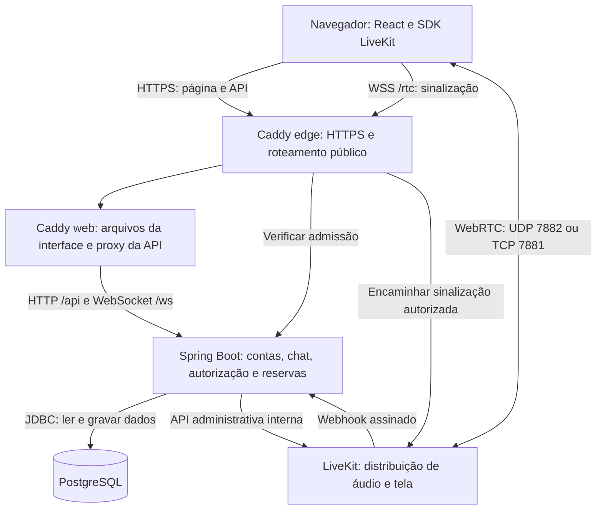

O áudio e o vídeo não passam pelo controlador Java de mensagens nem pelo PostgreSQL. Caddy transporta sinalização HTTP/WSS; os pacotes de mídia usam as portas da SFU.

### 3.2. Mapa do repositório

```text
chat-friends/
├── README.md                  entrada e comandos principais
├── AGENTS.md                  regras para trabalhar no repositório
├── backend/
│   ├── pom.xml                dependências e build Java
│   ├── mvnw                   Maven Wrapper
│   ├── src/main/java/com/chatfriends/
│   ├── src/main/resources/    configuração e migrações SQL
│   └── src/test/              testes Java
├── frontend/
│   ├── package.json           scripts e dependências JS
│   ├── package-lock.json      resolução fixada das dependências
│   ├── src/                   componentes e lógica do navegador
│   ├── tests/                 testes Playwright
│   └── Caddyfile              servidor/proxy da interface compilada
├── infra/
│   ├── compose/               serviços, redes e perfis dev/prd
│   ├── caddy/                 Caddy com provider DuckDNS protegido
│   ├── livekit/               imagem e entrypoint da SFU
│   ├── postgres/              imagem do banco
│   ├── macos/                 modelo do LaunchAgent
│   └── gcp/                   infraestrutura Terraform, sem apply automático
├── scripts/                   configuração, operação e verificações
├── security/                  exceções temporárias de vulnerabilidades
├── docs/                      guias, evidências e planos
└── .github/workflows/ci.yml    pipeline
```

Depois de configurar, aparecem também `.env`, `infra/compose/generated/` e `backups/`. São arquivos locais/privados, ignorados pelo Git; não devem ser adicionados com `git add -f`.

### 3.3. Os serviços do Compose

| Serviço | Responsabilidade | Duração |
|---|---|---|
| `db` | Executa PostgreSQL e preserva dados no volume | Contínua |
| `backend` | Atende a API e o WebSocket de eventos | Contínua |
| `livekit` | Encaminha mídia | Contínua |
| `web` | Serve os arquivos React compilados e encaminha API/eventos | Contínua |
| `edge` | Recebe HTTPS público e gerencia certificados em prd | Contínua em prd |
| `migrate` | Aplica migrações com credenciais próprias | Job temporário de manutenção |

Existem tarefas temporárias de configuração e permissões que os scripts coordenam. Não é necessário iniciá-las manualmente no primeiro contato.

O Caddy aparece duas vezes porque existem dois papéis: servir a interface e receber o tráfego público com TLS. A imagem `web` não recebe o token DuckDNS.

### 3.4. Redes internas

| Rede | Serviços principais | Propósito |
|---|---|---|
| `database_net` | Banco, backend e migrador | Acesso ao banco |
| `api_net` | Web, edge e backend | Requisições da aplicação |
| `control_net` | Backend e LiveKit | Controle administrativo e webhook |
| `signal_net` | Proxies e LiveKit | Sinalização da chamada |
| `ingress_net` | Entrada/saída necessária ao proxy | Conectividade do serviço de entrada conforme o modo |
| `media_net` | LiveKit | Rede que recebe as portas de mídia |

As quatro primeiras são internas. O backend não recebe uma ponte externa para navegação geral. Isso reduz os caminhos entre serviços, mas não substitui o firewall do host ou o isolamento da rede doméstica.

O entrypoint da SFU descobre a interface da rota IPv4 padrão e restringe os candidatos ICE a ela. Isso evita anunciar o mesmo IP público através de interfaces internas diferentes e acabar escutando UDP na interface errada. O nome `eth0` não é assumido.

## 4. Primeira execução local

### 4.1. Escolha um ambiente de desenvolvimento separado

O projeto tem somente dois modos de stack:

| Modo | Finalidade | Endereço típico |
|---|---|---|
| `dev` | Desenvolvimento no próprio computador | `http://localhost:8080` |
| `prd` | Uso pela internet, com autenticação e HTTPS | `https://seu-app.duckdns.org:18443` |

`CHAT_MODE` é definido no comando, não dentro do `.env`. O mesmo checkout não deve rodar os dois modos ao mesmo tempo sobre o mesmo banco. Trocar o valor da variável também não converte automaticamente todas as URLs e regras de rede.

Se o computador já possui uma instalação prd, não use a sequência de instalação nova sobre ela. Faça manutenção conforme [SECURITY_UPGRADE](SECURITY_UPGRADE.md) e mantenha o desenvolvimento em ambiente separado, incluindo armazenamento e portas.

### 4.2. Pré-requisitos

No Mac: OrbStack ativo, Docker CLI/Compose, Git e Bash. No Linux: Docker Engine e Compose. O mínimo documentado de Compose é **2.24.4**.

Confira a disponibilidade:

```bash
git --version
docker version
docker compose version
```

`docker version` deve conseguir falar com o daemon, o processo que executa os contêineres. Se houver erro de conexão, iniciar só o terminal não basta: o OrbStack/daemon precisa estar em funcionamento.

Java e Node não são exigidos no host para o fluxo principal. Os scripts usam imagens que já contêm essas ferramentas. Reserve espaço para downloads e builds; o consumo durante a compilação pode superar bastante os limites dos serviços em execução.

### 4.3. Obtenha o código e inicie dev

Em uma instalação nova de desenvolvimento:

```bash
git clone --branch work https://github.com/dhtNEO/chat-friends.git
cd chat-friends
CHAT_MODE=dev ./scripts/up.sh
```

O exemplo seleciona `work`, branch que reúne a implementação descrita na data deste guia. Se a equipe adotar outra branch ou release com essas mudanças, selecione a versão combinada com o responsável antes de iniciar.

O `up.sh` faz mais do que executar `docker compose up`:

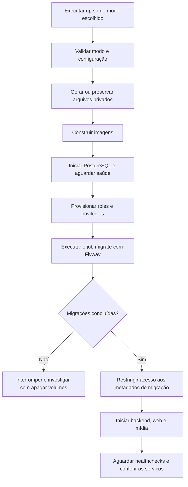

Em prd com DuckDNS, o fluxo passa também pelo atualizador e pelo lock descritos na seção 10. O objetivo permanece: configurar, construir, migrar e só então iniciar a aplicação.

### 4.4. Entenda os arquivos gerados

| Arquivo/diretório | Conteúdo e cuidado |
|---|---|
| `.env` | Configuração do operador e credenciais iniciais; não substituir o arquivo de uma instalação existente por um exemplo |
| `infra/compose/generated/runtime.env` | Credenciais separadas do banco, chave MFA, chave entre proxies e UID/GID do operador |
| `infra/compose/generated/helper.env` | Configuração mínima entregue ao helper de rede; não contém senha do banco ou chave MFA |
| `infra/compose/generated/livekit.yaml` | Configuração ativa da SFU; contém segredo e deve permanecer privada |
| `infra/compose/generated/mode` | Marcador do modo configurado |
| `infra/compose/generated/network/network.env` | Overrides validados de rede, usados no perfil público |
| `infra/compose/generated/duckdns/` | Token, configuração e estado do atualizador |
| `infra/compose/generated/duckdns-logs/` | Logs privados do agendador, com rotação |
| `infra/compose/generated/operator-backups/` | Arquivos antigos preservados durante a atualização do isolamento do helper |
| `backups/` | Dumps e bundles criados pelo operador |

Arquivos privados usam permissões restritas, normalmente `0600`; diretórios privados usam `0700`. Em termos simples: somente o proprietário deve conseguir ler/escrever esses dados. Não gere uma nova chave MFA a cada deploy: a chave existente é necessária para ler os segredos já cifrados.

### 4.5. Crie o administrador e confira a saúde

```bash
./scripts/admin.sh admin
./scripts/diagnose.sh
```

O primeiro comando pede uma senha sem mostrá-la no terminal. Não há senha padrão. O nome de usuário precisa seguir o formato aceito; senhas têm mínimo de 12 caracteres e máximo de 72 bytes UTF-8. Acentos podem ocupar mais de um byte.

Executar o bootstrap para um administrador já existente não troca sua senha. Para problemas de acesso, use o procedimento de administração/recuperação correspondente.

Abra **`http://localhost:8080`**. Neste endereço, `localhost` é o próprio computador do navegador. Um amigo usando `localhost` no celular acessaria o celular, não o seu Mac.

Uma verificação HTTP simples é:

```bash
curl --fail --show-error http://localhost:8080/api/health
```

A resposta saudável é `{"status":"ok"}`. Ela verifica a API e acesso ao banco; não testa áudio, captura de tela ou acesso externo.

### 4.6. Como alterar a interface durante o estudo

O fluxo principal serve um **build compilado** pelo Caddy. Alterar um `.tsx` não muda automaticamente o JavaScript já entregue por esse contêiner. Depois de uma alteração em dev, `CHAT_MODE=dev ./scripts/up.sh` reconstrói as imagens necessárias e atualiza a stack.

Para aprender apenas a interface com atualização rápida, existe a **demo**. Execute a partir da raiz do projeto:

```bash
docker run --rm -it \
  --user "$(id -u):$(id -g)" \
  -e npm_config_cache=/tmp/npm-cache \
  -p 127.0.0.1:5173:5173 \
  -v "$PWD/frontend:/src" -w /src \
  node:24.22.1-alpine \
  sh -c 'npm ci && npm run demo'
```

Abra `http://localhost:5173`. Use credenciais fictícias; não há autenticação real nessa simulação. `Ctrl+C` encerra o processo. A demo simula API, participantes e mídia dentro da página e é uma opção do Vite, não um terceiro modo de implantação da stack. Não comprova funcionamento do backend ou da rede.

Se Node estiver instalado no host, a alternativa é executar `npm ci` e `npm run demo` dentro de `frontend/`.

O script `npm run dev` é outro caso: ele não inicia o backend. O proxy Vite atual aponta para `localhost:8081`, que não é publicado pela stack padrão. Um ambiente com hot reload e backend real exige um override de desenvolvimento revisado, mantendo origem, cookies e WebSocket coerentes. Para começar, use o build completo ou a demo.

## 5. Como o frontend funciona

### 5.1. Entrada da página e componentes

`frontend/src/main.tsx` inicia o React. O componente principal é `App.tsx`, que consulta `/api/me` para saber se há uma sessão válida e se existe uma etapa de MFA pendente.

| Arquivo | O que procurar nele |
|---|---|
| `App.tsx` | Login, carregamento da conta, workspace, chat e conexão de eventos |
| `api.ts` | Requisições HTTP, token CSRF e tratamento da sessão encerrada |
| `AccountSecurity.tsx` | Inscrição/verificação MFA, reautenticação e gerenciamento de sessões |
| `Profile.tsx` | Nome, usuário, avatar, aparência, sons e alteração de senha |
| `Dock.tsx` | Painéis, slots, restauração do layout e adaptação a telas menores |
| `Voice.tsx` | Ciclo de vida da sala, captura, publicação, heartbeats e controles de áudio |
| `MediaPlayback.tsx` | Reprodução de tracks, vídeo e controles do player |
| `MicrophoneGain.ts` | Processamento do ganho antes da publicação do microfone |
| `useAudioSettings.ts` | Preferências locais de áudio por conta |
| `Popout.tsx` | Transmissão em outra janela |
| `sounds.ts`, `theme.ts`, `ui.tsx` | Efeitos, aparência e elementos compartilhados |
| `demo/` | Dados e comportamentos simulados da demo |

Um componente React descreve o que deve aparecer a partir de seu estado. `useState` guarda estado da interface; `useEffect` conecta esse componente a recursos externos e deve limpar timers, listeners e conexões quando deixam de ser necessários. `useRef` guarda referências estáveis, como a instância da sala, sem exigir uma renderização a cada mudança.

Ao trabalhar com microfone/tela, essa limpeza é parte do comportamento: remover um botão da tela não encerra sozinho uma captura que ficou aberta.

### 5.2. Estado de interface, estado local e estado do servidor

| Tipo de estado | Exemplos | Autoridade |
|---|---|---|
| Temporário da interface | Formulário, erro exibido, botão ocupado | Componente React |
| Preferência local | Volume, sons personalizados, escala e layout | Navegador, em `localStorage` |
| Dado persistente da conta | Nome, cores do perfil, avatar e mensagens | Backend/PostgreSQL |
| Estado de autorização | Sessão válida, papel de admin, permissão de tela | Backend e permissões da SFU |

`localStorage` não é banco compartilhado e não é usado para guardar o cookie de autenticação. Alterar o volume de uma pessoa no seu navegador não altera o volume dos outros ouvintes. Usar outro navegador pode exigir configurar novamente essas preferências.

### 5.3. Por que os painéis não podem controlar sozinhos a chamada

O workspace mantém o ciclo de vida da voz enquanto o Dockview movimenta os painéis. Os slots e portais permitem trocar a posição de um painel sem reconstruir toda a conexão de mídia.

Por isso, **fechar o painel da sala não equivale a sair da chamada**. Essa distinção evita que arrastar uma aba interrompa o microfone. Ao mudar essa área, confira onde o estado e os recursos realmente são criados e destruídos.

No celular, painéis viram abas; um teste que procura uma mensagem precisa ativar a aba correta. Restaurar o layout salvo também pode abrir “Minha conta” em vez de “# geral”. Isso é comportamento de navegação, não necessariamente falha de login.

## 6. Como o backend recebe e autoriza uma requisição

### 6.1. Camadas e classes principais

Não há uma camada ORM/JPA: o projeto usa `JdbcTemplate` e SQL parametrizado. Os controladores recebem HTTP; classes de serviço organizam as regras; o banco aplica transações e restrições.

| Arquivo Java | Responsabilidade |
|---|---|
| `Application` | Inicialização Spring e configuração compartilhada |
| `Bootstrap` | Comandos temporários de administrador, migração e recuperação MFA |
| `Security` | Filtros de autenticação, CSRF e autorização |
| `RequestGuard`, `RequestBudget` | Limites antes da criação de sessões, tamanho de corpo e uso limitado de memória |
| `SessionSecurity` | MFA pendente, prazo da sessão e confirmação recente de identidade |
| `Accounts`, `Profiles` | Contas, senhas, perfil e avatar |
| `Api` | Rotas de aplicação, chat e administração |
| `AccountSecurityApi`, `Mfa` | TOTP, recuperação e sessões próprias |
| `Chat`, `RateLimit` | Persistência/idempotência do chat e limites de negócio |
| `WebSockets`, `Events` | Handshake, eventos e presença |
| `Media` | Conexões de voz e concessão/revogação da tela |
| `MediaAdmission` | Revalidar e restringir o token usado na sinalização |
| `LiveKitGateway`, `Webhook` | Comunicação administrativa e eventos assinados da SFU |
| `MigrationHistory` | Seleção do histórico Flyway compatível |

Anotações como `@RestController` e `@PostMapping` ligam uma classe/método a uma rota HTTP. `@Service` marca uma classe de serviço. A injeção por construtor permite receber dependências e substituí-las por mocks nos testes em que isso é apropriado.

### 6.2. Login, cookie e CSRF, passo a passo

Uma sessão associa um identificador do navegador à autenticação guardada no servidor. O cookie `SESSION` leva o identificador; ele não contém a senha.

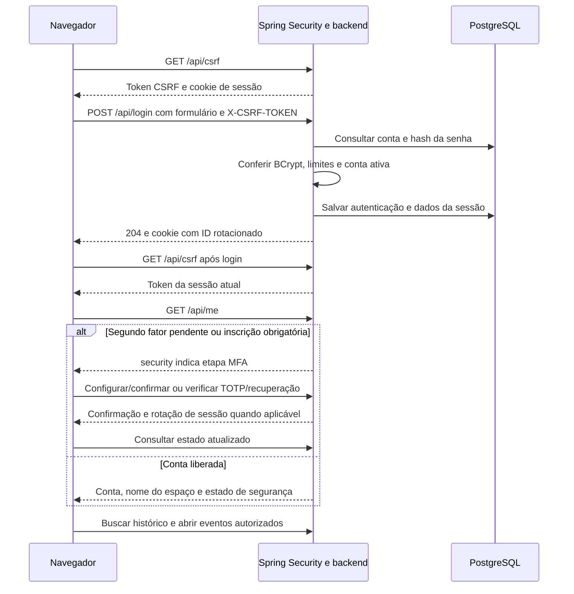

**Por que CSRF?** O navegador envia cookies automaticamente. O token adicional dificulta que outro site provoque operações usando a sua sessão. O frontend obtém o token e o envia no cabeçalho `X-CSRF-TOKEN` em POST/PUT/PATCH/DELETE. Até login e logout são protegidos.

O cookie é `HttpOnly`, para impedir sua leitura pelo JavaScript da página; `SameSite=Strict` restringe seu envio entre sites; `Secure` é habilitado em prd para exigir HTTPS. Esses controles se complementam.

### 6.3. MFA, expiração e reautenticação

MFA adiciona uma prova além da senha. O TOTP é um código de seis dígitos que muda com o tempo em um autenticador. O servidor precisa manter o relógio correto e rejeitar a reutilização de códigos já aceitos.

1. A configuração pede confirmação da senha e gera uma chave temporária de inscrição.
2. A pessoa adiciona a chave ao autenticador e confirma um código em até 10 minutos.
3. O servidor ativa MFA e mostra oito códigos de recuperação de uso único.
4. Nos logins seguintes, a senha é seguida de um código TOTP ou de recuperação.

Administradores precisam concluir a inscrição em prd; usuários comuns podem ativá-la na seção **Segurança**, em **Configurações → Conta**. Enquanto houver etapa obrigatória pendente, chat, administração, eventos e mídia permanecem bloqueados.

A inatividade da sessão tem limite de **2 horas**; o prazo absoluto é de **8 horas**, mesmo com uso contínuo. Depois de **15 minutos** sem confirmação recente, operações administrativas, alteração da própria senha e encerramento forçado de tela podem exigir reautenticação. A resposta é HTTP `428`; a pessoa confirma sua identidade e repete a ação.

BCrypt e AES-GCM têm funções diferentes. O hash BCrypt da senha é conferido sem recuperar a senha original. O segredo TOTP precisa ser lido pelo servidor para verificar códigos, então fica cifrado com AES-GCM e depende da chave MFA preservada no arquivo privado de runtime.

### 6.4. Como interpretar respostas da API

| Status | Interpretação usual | Próximo passo |
|---|---|---|
| `200` / `204` | Operação concluída; `204` não tem corpo | Atualizar o estado conforme o contrato |
| `400` | Dados inválidos | Corrigir a entrada |
| `401` | Sessão/autenticação inválida ou conta desativada | Pedir novo login |
| `403` | CSRF, origem, papel ou etapa MFA não permitem a ação | Conferir a condição de segurança |
| `409` | Conflito, reserva ocupada ou conexão de mídia expirada | Recarregar estado ou entrar novamente na voz conforme a rota |
| `428` | Identidade precisa de confirmação recente | Reautenticar e repetir explicitamente |
| `429` | Limite de tentativas/requisições atingido | Aguardar a janela; evitar loops de retry |
| `503` | Serviço de mídia indisponível ou revogação não concluída | Preservar chat e investigar a SFU |

O significado exato depende da rota. Uma conexão de voz expirada recebe `409`; isso não deve deslogar o chat. Já um `401` faz `api.ts` avisar que a sessão terminou. Envio binário de avatar também participa desse tratamento.

## 7. Banco de dados e migrações

### 7.1. As tabelas principais

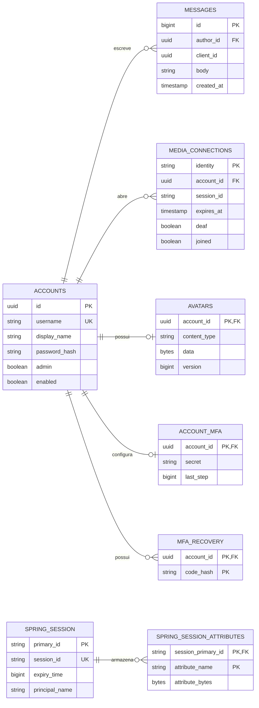

No diagrama, `PK` é chave primária, `FK` é chave estrangeira e `UK` indica unicidade. Os símbolos representam relações como uma conta para várias mensagens. Colunas secundárias foram omitidas para facilitar a leitura.

Há também `rate_limits`, para limites persistentes de negócio, e `screen_lease`, com três vagas fixas que representam as reservas de até três transmissões simultâneas autorizadas. O Flyway mantém `flyway_schema_history` para registrar migrações.

`media_connections.session_id` é uma associação lógica conferida pelo código; não há uma FK correspondente desenhada para sessões. O identificador público de gerenciamento de uma sessão também é diferente do valor secreto do cookie.

### 7.2. Por que existem usuários diferentes no banco

| Identidade | Uso |
|---|---|
| Operador/DBA | Inicialização, provisão e manutenção privilegiada |
| `friends_owner` | Role proprietária sem login, usada na organização de permissões |
| `friends_migrator` | Executa alterações de esquema no job temporário |
| `friends_app` | Backend permanente: leitura e escrita de dados, sem DDL ou superusuário |
| `friends_tests` | Testes locais no banco separado `friends_test` |

Os nomes de runtime/migrador podem ser configurados dentro das validações previstas. A separação é o ponto principal: uma requisição comum não deve ter a credencial que cria tabelas, roles ou bancos.

**DML** é a manipulação de dados, como SELECT/INSERT/UPDATE/DELETE. **DDL** é a mudança de estrutura, como CREATE TABLE. O runtime recebe apenas os privilégios necessários e não lê os metadados de migração.

### 7.3. Como as migrações funcionam

Uma migração descreve uma evolução do esquema. O Flyway registra versão e checksum do SQL aplicado. Alterar um SQL já executado cria divergência entre instalações.

| Versão | Responsabilidade |
|---|---|
| `V1` | Estrutura inicial de contas, mensagens, sessões, conexões e lease |
| `V2` | Preferência de recepção `deaf` por conexão |
| `V3` histórico `profiles` | Cores do perfil e avatares |
| `V3` histórico `account_security` | Tabelas MFA/recuperação e encerramento de sessões antigas |
| `V4` | Estado `joined` do ciclo de vida de mídia |
| `V5` | Completa perfis e segurança conforme o histórico existente |

As duas `V3` surgiram em branches diferentes. Elas não são executadas juntas na mesma instalação: `MigrationHistory` consulta o histórico e escolhe a versão original em `db/legacy-main/` ou `db/legacy-security/`. Instalações novas seguem o histórico de perfis. `V5` completa as funcionalidades faltantes sem renumerar o histórico ou usar `repair` para esconder um problema.

Para uma alteração nova, confirme o próximo número livre e adicione uma migração em `db/migration/`. Na referência deste guia, o próximo seria `V6`; não assuma isso se o repositório já tiver evoluído. Preserve os SQLs antigos e teste atualização de banco existente, além da criação do zero.

## 8. O caminho completo de uma mensagem

### 8.1. Do campo de texto ao commit

O cliente gera um `clientId` para identificar **a intenção de envio**, independentemente de quantas tentativas de rede forem necessárias.

Exemplo conceitual com o helper do frontend:

```ts
const clientId = crypto.randomUUID();
const body = "Olá da documentação";

await api("/messages", "POST", { clientId, body });
// Se a resposta se perder, uma repetição deve usar o MESMO clientId e corpo.
```

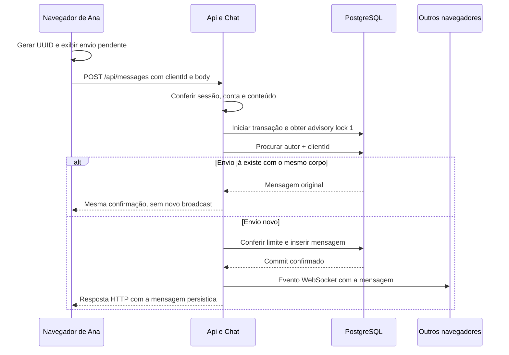

O broadcast e a resposta ao autor acontecem depois do commit; a ordem de chegada na rede pode variar. Falhar ao notificar um navegador não desfaz a mensagem já gravada.

O texto tem limite de 4.000 unidades UTF-16. Isso pode diferir do número de símbolos visuais em um texto com emojis. Há limite de 20 mensagens novas em 10 segundos por conta; uma repetição idempotente não deve consumir novamente esse limite.

### 8.2. Idempotência e concorrência

**Idempotência** significa que repetir a mesma operação reconhecida não cria outro efeito. Aqui, a chave é a combinação de autor e `clientId`; enviar o mesmo UUID com um corpo diferente dá `409`.

Imagine que a mensagem foi gravada, mas o Wi-Fi caiu antes da resposta. Gerar um UUID novo no retry faria o servidor entender que é outra mensagem. Reusar o UUID permite recuperar a confirmação original.

O `pg_advisory_xact_lock(1)` serializa o caminho de gravação do canal. Isso preserva uma ordem de commit compatível com o cursor: evita entregar um ID maior e só depois confirmar um ID menor que o cliente já teria ultrapassado na recuperação.

### 8.3. Atualização em tempo real e recuperação

O WebSocket `/ws` não recebe o texto para persistência: o envio do chat é HTTP. No socket, o cliente envia `ping`; o servidor envia `pong`, presença, mensagens e avisos de alteração de perfil.

O WebSocket é uma notificação, não uma fila durável. Ao reconectar, o frontend consulta o histórico:

| Consulta | Uso |
|---|---|
| `/api/messages` | Últimas 50 mensagens |
| `/api/messages?before=ID` | Carregar mensagens anteriores |
| `/api/messages?after=ID` | Recuperar até 100 posteriores ao último ID conhecido |

Se a página de recuperação tiver 100 resultados, pode haver mais: continuar consultando até receber uma página menor. A interface trata mensagens como texto, sem executar HTML enviado pelo usuário.

## 9. Voz, compartilhamento de tela e áudio

### 9.1. Entrando na voz

O backend não recebe os pacotes de microfone. Ele autoriza a conexão, gera a identidade por aba/sessão e fornece um JWT curto ao SDK LiveKit.

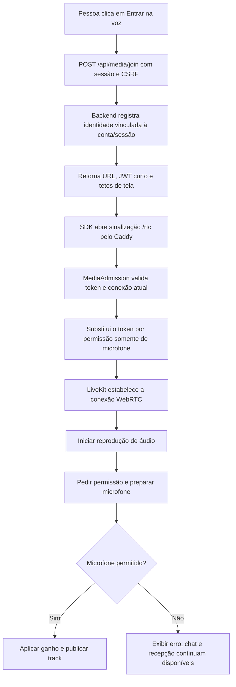

O JWT inicial dura cerca de 90 segundos. Ele permite entrar na sala prevista, com a identidade e fontes permitidas; não é o cookie de login. A aplicação não entrega o segredo usado para assinar JWTs ao frontend.

Uma chamada estabelecida não é encerrada automaticamente quando o token inicial expira. A validade da sessão, os heartbeats, as permissões e a reconciliação continuam necessários.

Na reconexão, o proxy sempre passa pela admissão. Isso impede reaproveitar um token antigo com permissão de tela para recuperar essa permissão indevidamente. A porta administrativa/sinalização direta `7880` permanece interna.

### 9.2. ICE e escolha do caminho de mídia

O ICE reúne candidatos de conectividade e testa caminhos. Na configuração padrão, a mídia principal usa UDP `7882`; TCP `7881` é uma alternativa. TURN pode ajudar em algumas redes restritivas, mas é uma configuração opcional e separada, não ativada automaticamente pelo DuckDNS.

Para investigar uma chamada, observe conexão, protocolo escolhido, bytes enviados/recebidos, perda, jitter e RTT. Uma porta TCP aberta não prova que o áudio foi recebido e decodificado.

O teste nativo de ICE envia STUN com autenticação e valida a resposta, inclusive integridade, nas duas portas. Uma sonda UDP precisa tolerar perda com retransmissão; ela não pode considerar qualquer pacote como sucesso. O teste também aguarda a conexão de mídia estar estabelecida antes de usar suas credenciais.

### 9.3. Como até três conexões recebem autorização de tela

A aplicação possui até três leases simultâneas, uma por conexão, cada uma com identidade, UUID e expiração de 30 segundos. Ela é renovada por heartbeat. A reserva no banco e a mudança de permissão na SFU são coordenadas, mas não constituem uma transação distribuída única.

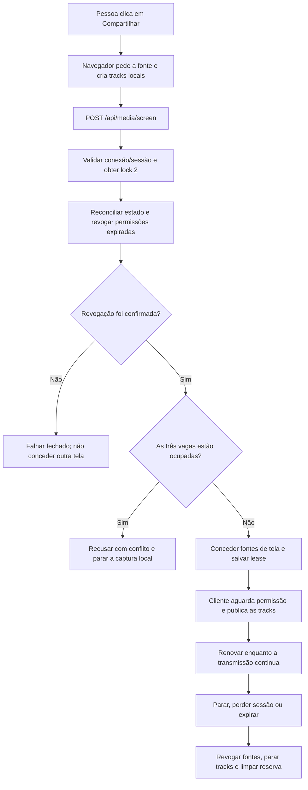

A captura é iniciada diretamente pelo gesto da pessoa, antes do pedido de rede, por causa das regras do navegador. Isso não publica o vídeo automaticamente: se a reserva for recusada, as tracks capturadas são encerradas.

O reconciliador roda nominalmente a cada 3 segundos. Webhooks assinados também acionam verificação. Um webhook fora de ordem não é aplicado cegamente; o backend consulta o estado atual da SFU.

Revogar antes de conceder preserva o limite de três reservas autorizadas. Ainda existe uma limitação: um cliente modificado que já tem a lease pode tentar publicar mais de uma track da mesma fonte. O reconciliador remove a conexão ao detectar o excesso, mas isso não garante zero sobreposição instantânea. Veja [SECURITY](SECURITY.md).

### 9.4. Heartbeats e desaparecimento de participantes

| Mecanismo | Referência atual |
|---|---|
| Ping do WebSocket | A cada 10 s; presença antiga é removida após cerca de 45 s, com verificação periódica |
| Heartbeat da conexão de voz | A cada 10 s; conexão precisa renovar antes de 45 s |
| Lease de tela | Validade de 30 s, renovada durante o compartilhamento |
| Reconciliação da mídia | Intervalo nominal de 3 s; falhas podem aumentar o tempo efetivo |

São controles diferentes porque página, chamada e transmissão podem parar em momentos diferentes. O campo `joined` ajuda a distinguir uma conexão apenas emitida daquela que realmente entrou na SFU. Eventos e consultas posteriores permitem retirar participantes que saíram, sem reviver uma conexão expirada.

### 9.5. Onde o volume realmente é aplicado

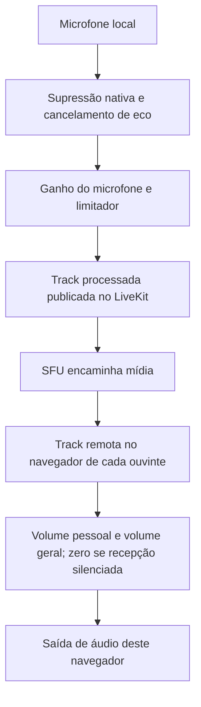

Há dois lados:

1. **Entrada:** `MicrophoneGain` usa Web Audio para processar a track antes da publicação. Aumentar seu ganho muda o que os outros recebem. Um limitador reduz picos, mas ganho excessivo ainda pode distorcer.
2. **Saída:** cada ouvinte aplica seus volumes. Com `webAudioMix`, o controle efetivo usa `RemoteAudioTrack.setVolume`. Mudar apenas `audio.volume` ou `muted` do elemento HTML pode deixar o grafo de áudio tocando.

Como exemplo de composição de ganhos, 80% de saída geral e 50% de volume de um participante correspondem a fator `0,8 × 0,5 = 0,4`. Recepção silenciada precisa resultar em zero, independentemente dos sliders. O som da transmissão tem controle local próprio.

O vídeo de tela fica sem som no elemento de vídeo; o áudio é reproduzido pelo caminho de tracks correspondente. A prévia do próprio transmissor permanece silenciosa para evitar eco. Na janela separada, o som continua na janela principal, evitando duas reproduções simultâneas.

`micMuted` reflete a publicação de microfone na SFU. `deaf` indica a preferência de recepção declarada pelo cliente autenticado. Nenhum desses indicadores prova o estado físico do volume do computador.

### 9.6. Full HD e 60 fps são tetos

O servidor limita resolução, FPS e bitrate; a UI oferece presets dentro desses limites. Os tetos atuais chegam a 1080p, 60 fps e 8 Mbps. O navegador pode entregar menos por causa da fonte escolhida, encoder, codec, CPU, banda e congestionamento.

A SFU encaminha o vídeo; não há um transcoder criando uma versão Full HD a partir de uma captura menor. A captura de áudio da tela também depende do sistema/navegador e da fonte. Tela funcionando sem áudio do sistema é um caso possível, especialmente ao comparar plataformas.

## 10. Produção: internet, roteador, DuckDNS e HTTPS

Esta etapa é feita em um host e uma rede autorizados para hospedar a aplicação. Um notebook conectado à rede do trabalho não deve iniciar o perfil público ou atualizar automaticamente o DNS sem essa decisão operacional.

### 10.1. IP local, IP público e DNS

O Mac tem um endereço na LAN, usado pelo roteador para encontrar a máquina. A conexão de internet tem um endereço WAN/público, usado por quem está fora. O DNS traduz o nome registrado para esse IP público.

DuckDNS fornece o nome e permite atualizar o IP associado. Ele não abre portas, não é uma VPN e não retransmite os pacotes de mídia.

Se houver CGNAT, existe outra camada de NAT na operadora. Abrir portas no roteador doméstico não remove essa camada. Comparar o IPv4 WAN com o IPv4 observado externamente ajuda a identificar o cenário, mas a validação de portas exige teste de fora da rede.

Private Relay e “Limitar rastreamento de endereço IP” podem permanecer ativos. A descoberta feita pelo atualizador precisa corresponder à WAN real; uma VPN/proxy de saída diferente pode produzir um IP inadequado. O endereço Wi-Fi privado fixo ajuda a manter a identidade usada na reserva DHCP daquela rede.

### 10.2. O caminho de entrada

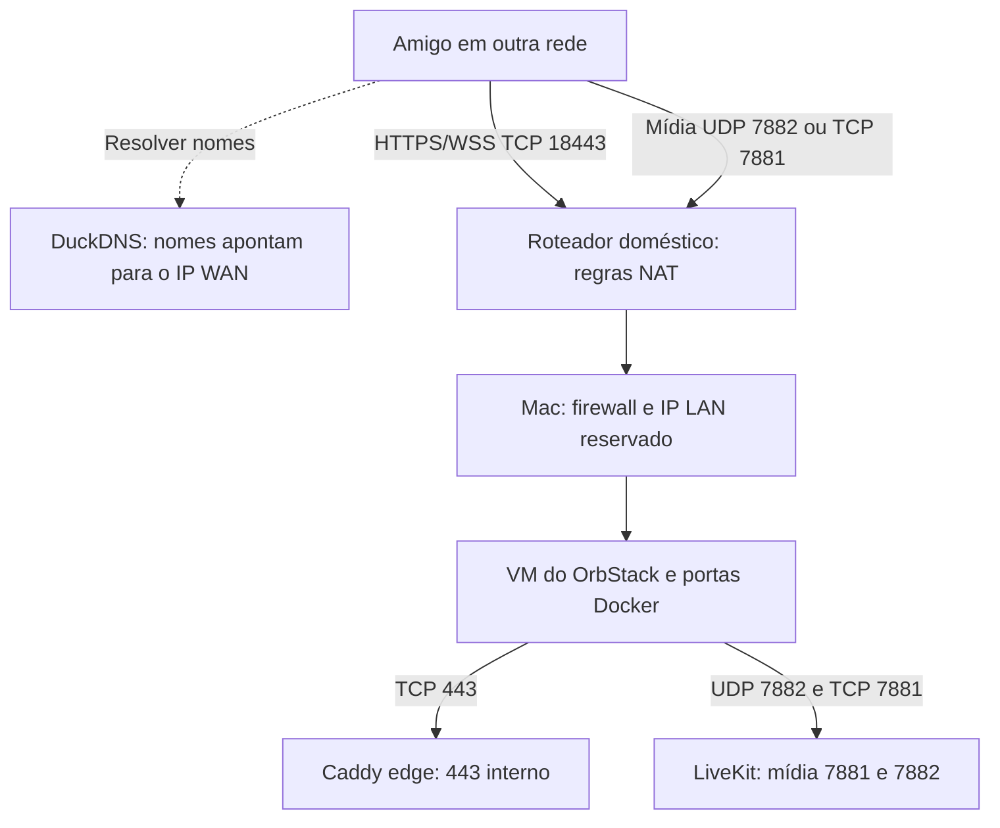

| Porta no roteador/WAN | Destino no Mac | Responsabilidade |
|---|---|---|
| TCP `18443` | TCP `443` no IP LAN reservado | Página, API e sinalização HTTPS/WSS |
| TCP `7881` | TCP `7881` no mesmo Mac | Alternativa de transporte de mídia |
| UDP `7882` | UDP `7882` no mesmo Mac | Transporte principal de mídia |

O `:18443` faz parte da URL pública. O navegador usa essa porta no roteador, embora o Caddy escute em 443 no Mac/contêiner. Banco `5432`, backend/web `8080`, API LiveKit `7880` e administração Caddy não devem ser encaminhados para a internet.

### 10.3. Por que existem dois nomes e DNS-01

Um nome é usado para a aplicação e outro para a sinalização de mídia. Ambos apontam ao mesmo IPv4 público, mas o Caddy escolhe o tratamento conforme o domínio e a rota. A política CSP permite a origem HTTPS/WSS de mídia configurada.

HTTPS precisa de um certificado confiável. No fluxo **ACME DNS-01**, o Caddy demonstra controle do domínio criando temporariamente um registro TXT `_acme-challenge`. A autoridade certificadora verifica esse registro e emite o certificado.

Essa validação não exige entrada WAN nas portas 80 ou 443. O acesso público continua exigindo TCP 18443; a mídia continua exigindo suas portas. DNS-01 resolve a emissão do certificado, não o caminho WebRTC.

O token DuckDNS fica em arquivo privado e é montado como secret. O módulo `duckdns_private` filtra erros que poderiam expor o token. O Caddy ainda precisa acessá-lo durante a renovação: isso é um risco residual a considerar, não um segredo que possa ser publicado no frontend.

### 10.4. Sequência de uma primeira instalação pública

Use [DUCKDNS_SETUP](DUCKDNS_SETUP.md) como procedimento operacional completo. A sequência é:

1. Confirmar conectividade pública e registrar dois nomes próprios na conta DuckDNS.
2. Reservar o IP LAN do Mac no DHCP e revisar firewall/IPv6, UPnP, DMZ e gerência remota.
3. Fazer backup e parar a stack anterior, preservando volumes.
4. Executar `./scripts/duckdns-init.sh` e informar os nomes, e-mail, WAN, porta pública e token em entrada oculta.
5. Criar somente os três encaminhamentos de porta da tabela anterior.
6. Iniciar com `CHAT_MODE=prd CHAT_ACME_STAGING=true ./scripts/up.sh` para verificar a emissão DNS-01 na CA de testes.
7. Após confirmar o fluxo de emissão pelos diagnósticos, parar o perfil staging e iniciar prd sem `CHAT_ACME_STAGING=true`, obtendo certificado de produção.
8. Criar/confirmar o administrador, concluir MFA e testar com outra rede, incluindo áudio e frames de tela recebidos.
9. Instalar o agendamento DuckDNS somente no host que permanecerá servindo a aplicação.

O certificado de staging não é confiável para uso normal; a troca para produção não é feita ignorando erros TLS. As opções staging/DNS-01 pertencem a prd, não são modos extras.

O acesso pelo domínio público de dentro da própria LAN pode depender de **NAT hairpin**. Como 18443 externa vira 443 no Mac, resolver o nome localmente para o IP LAN não basta se o Mac não atender 18443 nesse caminho. O diagnóstico interno pode passar enquanto esse acesso local ainda precisa de ajuste.

### 10.5. Como o IP dinâmico é atualizado

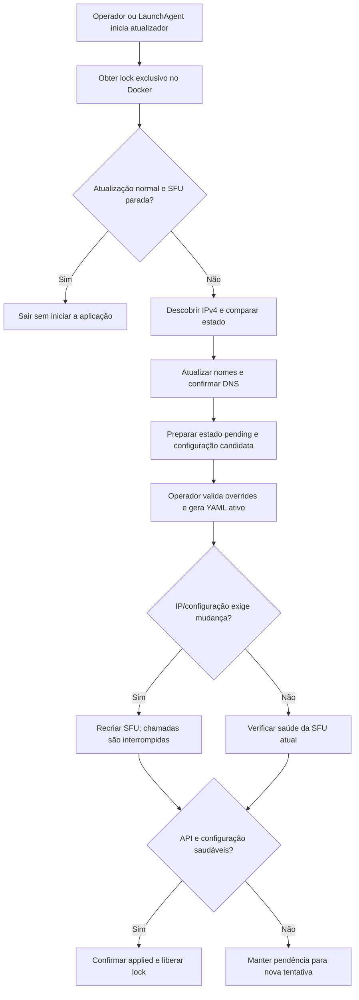

O parâmetro explícito `--start`, usado no startup, pode iniciar a stack; a atualização periódica normal não deve ressuscitar uma stack parada.

O lock impede duas atualizações simultâneas. `pending` registra uma mudança preparada; `applied` só avança depois da confirmação de saúde. Diagnosticar não é o mesmo que confirmar aplicação.

O helper recebe scripts somente para leitura, configuração mínima e escrita nos diretórios de estado necessários. Ele não recebe o socket Docker, as senhas do banco ou a chave MFA. O chamador valida uma lista fechada de overrides e gera o YAML ativo fora da área gravável do helper.

### 10.6. O que fica instalado no Mac

`./scripts/install-duckdns-launchagent.sh` cria `~/Library/LaunchAgents/org.chatfriends.duckdns.plist`. Ele chama o atualizador a cada cinco minutos após login; o OrbStack precisa estar ativo.

O plist contém caminhos de execução, não o token. Logs ficam na pasta gerada do projeto. O script com argumento `remove` descarrega o serviço e apaga o plist, preservando os dados e o token.

Parar o agendamento não para a aplicação. Parar os contêineres não apaga as regras do roteador. O nome DuckDNS pode continuar resolvendo para o último IP, mesmo com os serviços desligados. Cada parte precisa ser compreendida separadamente.

## 11. Testes e pipeline

### 11.1. Comece pela verificação integrada de dev

Em uma stack de desenvolvimento separada:

```bash
./scripts/check.sh
```

O script configura dev, prepara o banco **`friends_test`**, usa a role de testes, executa `clean verify` no backend e faz instalação/lint/build do frontend em contêineres. Ele não executa automaticamente toda a suíte de navegador.

Os testes de integração truncam tabelas de fixtures. Nunca aponte a suíte Java para o banco `friends` de uso real. `check.sh` recusa uma stack marcada como prd.

### 11.2. O que cada camada de teste demonstra

| Camada | Exercita | Limite da evidência |
|---|---|---|
| Java unitário | Regras como orçamento de requests e política de sessão | Não prova rede ou navegador |
| Java/PostgreSQL | Persistência, concorrência, autorização, perfil e migração dos dois históricos | Gateway administrativo é mockado em cenários de falha/corrida |
| Node | Scripts, modos, locks/estados simulados e criptografia de backup | Mocks DNS não provam propagação pública |
| Docker/runtime | Usuários, capabilities, redes, privilégios do banco e socket da interface de mídia | Não prova firewall da LAN ou do Mac |
| Playwright | Navegador com API/SFU, áudio e tela sintéticos, MFA, layout e CSP | Não prova captura de qualquer jogo/SO nem carga real de 16 pessoas |
| TLS de laboratório | HTTPS, SNI e política de acesso com CA de teste confiável | Não é emissão ACME pública da conta do proprietário |
| Scans | Dependências, imagens e padrões de segredos | Não garantem ausência de vulnerabilidades desconhecidas |

Os testes de áudio medem a saída Web Audio; o teste de vídeo verifica dimensões decodificadas. Conferir somente o texto “mudo” em um botão não provaria silêncio real.

### 11.3. Executar partes da validação

Se Node estiver disponível para essas ferramentas no host:

```bash
node --test scripts/tests/*.test.mjs
```

No frontend, com dependências instaladas:

```bash
cd frontend
npm ci
npm run lint
npm run build
```

Playwright precisa de uma stack de testes em execução, navegador compatível, administrador descartável e variáveis privadas `TEST_ADMIN_PASSWORD` e `TEST_LIVEKIT_SECRET`. `CHROMIUM_PATH` pode selecionar um navegador instalado. A criação e entrega dessas credenciais estão automatizadas no job `stack`; não copie o valor de segredos para comandos publicados ou exemplos de documentação.

Não execute esses testes contra contas e mensagens reais. Consulte [TESTING](TESTING.md) e o workflow para preparar o ambiente descartável. Relatórios de falha podem conter campos preenchidos e devem permanecer privados.

### 11.4. O que acontece no CI

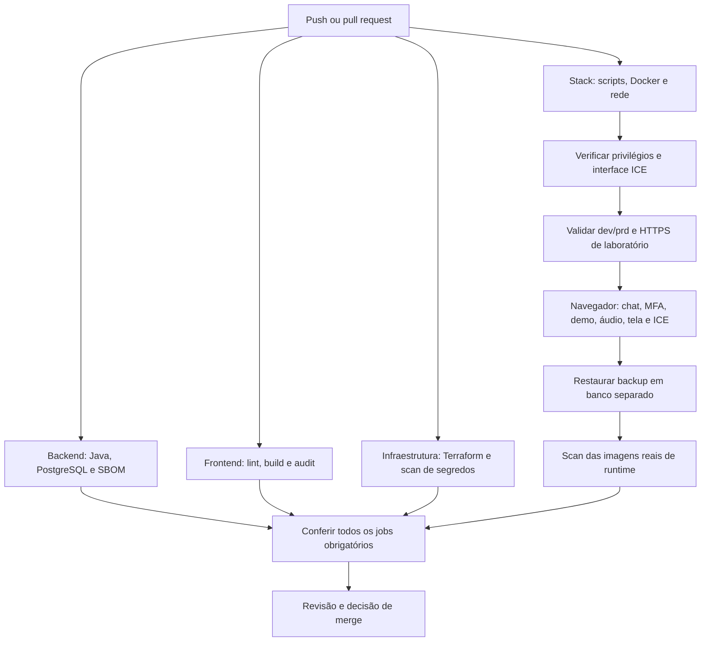

O job opcional `multiarch` é iniciado manualmente para construir AMD64/ARM64 sem publicar imagens. Ele não substitui testes humanos no Mac.

O scan Java usa o SBOM CycloneDX resolvido; o restante verifica SO e bibliotecas das imagens. Exceções são específicas, justificadas e têm vencimento em `security/vulnerability-exceptions.json`. Aumentar exclusões para fazer a pipeline passar não é correção.

Na referência deste guia, a integração foi validada com **43 testes Java, 27 Node e 13 Playwright**, e a [execução de CI da integração](https://github.com/dhtNEO/chat-friends/actions/runs/40441318078) passou. Esses números são evidência dessa versão, não uma meta fixa para versões futuras.

## 12. Operação: parada, backup e recuperação

### 12.1. Comandos que ajudam no dia a dia

Execute os exemplos desta tabela na raiz do projeto; em prd, mantenha o prefixo indicado.

| Intenção | Exemplo em prd |
|---|---|
| Ver serviços | `CHAT_MODE=prd ./scripts/compose.sh ps` |
| Diagnóstico da aplicação | `CHAT_MODE=prd ./scripts/diagnose.sh` |
| Diagnóstico DuckDNS/TLS | `CHAT_MODE=prd ./scripts/diagnose-duckdns.sh` |
| Logs recentes | `CHAT_MODE=prd ./scripts/compose.sh logs --tail=80 backend livekit` |
| Validar Compose sem mostrar segredos | `CHAT_MODE=prd ./scripts/compose.sh config -q` |
| Conferir privilégios | `CHAT_MODE=prd ./scripts/check-db-privileges.sh` |
| Parar a stack | `CHAT_MODE=prd ./scripts/compose.sh down --remove-orphans` |

O diagnóstico DuckDNS usa também o caminho interno Docker, para validar certificados sem exigir hairpin NAT. Ele não comprova acesso de um amigo pela internet. Teste fora do Wi-Fi, por exemplo com dados móveis.

Logs precisam ser revisados antes de compartilhar. Não publique `.env`, YAML privado, JWT, cookie, URL com `access_token`, dump ou configuração Compose expandida. Um erro de conexão pode incluir uma URL sensível.

### 12.2. Parar preserva dados; excluir volumes pode apagá-los

`down` remove os contêineres/redes previstos, preservando volumes nomeados. O banco e os certificados não ficam somente no filesystem descartável dos contêineres.

**Não acrescente `-v` ao `down` com dados importantes.** Remover volume ou executar limpeza global de volumes não é procedimento de diagnóstico.

Para retirar o agendamento no Mac antes de parar prd:

```bash
./scripts/install-duckdns-launchagent.sh remove
CHAT_MODE=prd ./scripts/compose.sh down --remove-orphans
```

Depois, `docker ps --filter label=com.docker.compose.project=chat-friends` deve mostrar o cabeçalho sem contêineres em execução. O `launchctl print` do label removido deve informar que o serviço não foi encontrado.

Ao levar o computador para outra rede, desligue o agendamento e a aplicação antes. As regras do roteador de origem continuam existindo e precisam ser desativadas lá se a exposição será encerrada.

### 12.3. Se o Compose não consegue nem parar por falta de variáveis

Um checkout novo pode exigir `runtime.env` enquanto contêineres antigos ainda estão ativos. O Compose valida a configuração antes de executar `down`, então erros como `APP_PROXY_KEY is missing` podem impedir a parada.

Para uma **parada de emergência**, não é necessário gerar credenciais nem subir serviços. Use os labels Docker do projeto:

```bash
docker ps -aq --filter 'label=com.docker.compose.project=chat-friends' |
while IFS= read -r container; do
  docker update --restart=no "$container"
  docker stop --time 45 "$container"
done
```

O procedimento desativa o reinício automático e encerra os contêineres encontrados sem apagar volumes. Confira a saída e o estado final; se o daemon estiver desligado, os comandos Docker não conseguem consultá-lo.

Encerre o OrbStack caso o objetivo seja parar toda a VM, sabendo que isso afeta os demais contêineres nela. Na retomada, siga a atualização/configuração correta e revise as políticas de reinício; não basta abrir o navegador.

### 12.4. O que precisa entrar no backup

| Item | Por que importa |
|---|---|
| Dump PostgreSQL | Contas, histórico, perfis, avatares e dados MFA |
| `.env` e `runtime.env` | Configuração e credenciais compatíveis com a instalação |
| Chave MFA existente | Permite ler os segredos TOTP cifrados |
| Estado/token DuckDNS | Autoridade de atualização de nomes e dados necessários à operação |
| Certificados/configurações de rede | Recuperação do serviço HTTPS e do perfil configurado |
| Versão do código/imagens | Aplicação e esquema precisam ser compatíveis |

Um dump simples não inclui toda essa configuração. O bundle criptografado reúne dados e arquivos privados; os certificados disponíveis são incluídos quando o edge está ativo.

Com a instalação configurada e em manutenção:

```bash
CHAT_MODE=prd ./scripts/backup-encrypted.sh
CHAT_MODE=prd ./scripts/test-backup.sh
```

O primeiro pede uma frase e gera um `.cfbackup` autenticado com AES-256-GCM. Guarde uma cópia fora do Mac e a frase separadamente. O segundo cria e restaura um dump em banco temporário e compara contagens; execute sem novas escritas durante a comparação.

`test-backup.sh` testa o dump do banco, não uma recuperação completa do bundle criptografado. Para comprovar essa recuperação, é necessário autenticar/abrir o bundle, conferir a configuração e ensaiar restauração em instalação isolada.

### 12.5. Como pensar a restauração

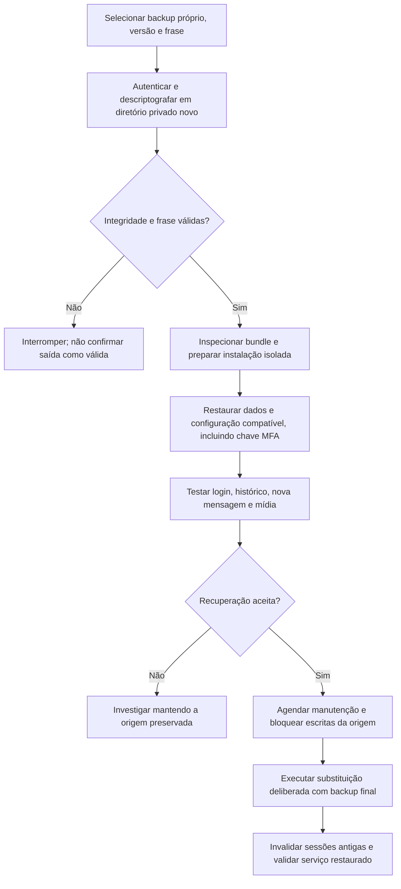

`open-backup.sh` autentica e abre o arquivo em uma pasta privada nova; não extrai automaticamente o tar sobre o projeto. O comando de restauração real exige `CONFIRM_RESTORE=REPLACE_DATABASE` porque substitui dados, não é uma simulação. Execute-o seguindo [BACKUP_RESTORE](BACKUP_RESTORE.md).

Rollback também exige cuidado: se uma versão nova já recebeu mensagens, voltar para um banco antigo perde essas mensagens. Primeiro bloquear escritas e reconciliar/restaurar o estado mais recente com uma versão compatível. Chamadas ativas não são transportadas entre hosts.

## 13. Segurança: o que foi protegido e o que ainda depende do operador

### 13.1. Controles que o desenvolvedor precisa preservar

| Controle | Evita/reduz |
|---|---|
| BCrypt e ausência de senha padrão | Armazenamento de senha em texto e credenciais iniciais conhecidas |
| CSRF, cookie protegido e origem WebSocket exata | Operações indevidas a partir de outra origem |
| MFA e reautenticação | Uso da senha isolada e de sessões antigas para ações sensíveis |
| Queries parametrizadas e texto escapado pelo React | Injeção SQL e execução de HTML de mensagens |
| CSP com origens necessárias | Conexões/scripts fora da política prevista |
| Limites de corpo, tentativas, sessões e sockets | Consumo descontrolado de recursos e tentativas automatizadas |
| Runtime sem DDL, migrador temporário | Uso cotidiano da credencial privilegiada do banco |
| Usuários limitados, rootfs RO e capabilities reduzidas | Alcance de falhas dentro dos contêineres |
| Helper com mounts mínimos e validação de overrides | Acesso do atualizador às credenciais de banco/MFA ou ao código gravável |
| Admissão de mídia e reconciliação | Reuso indevido de permissões e conexões órfãs |

O IP de cliente só é confiado quando a cadeia de proxies confirma o segredo compartilhado esperado. Não basta receber um `X-Forwarded-For` enviado por qualquer visitante.

Avatares são binários limitados a 16 KB, com formatos aceitos e bytes iniciais conferidos; não existe upload genérico de arquivos. Um futuro upload de MP3 precisará de um desenho próprio, incluindo exceção de tamanho estrita, autorização e validação real do conteúdo.

### 13.2. Limites e verificações pendentes

- **Rede real:** confirmar firewall, IPv6, firmware, gerência remota, encaminhamentos e acesso de contêineres à LAN. Docker não substitui isolamento do host.
- **Dados:** backup externo, FileVault, códigos de recuperação e ensaio no hardware do operador continuam necessários.
- **DuckDNS:** o Caddy acessa o token para renovação. Conta dedicada reduz o alcance; emissor separado é uma evolução possível.
- **Mídia:** reconciliação não é uma proibição atômica de múltiplas tracks; limites solicitados ao encoder não são uma barreira rígida contra cliente modificado.
- **Disponibilidade:** rate limits não impedem saturação do link doméstico por DDoS. Há um único host, sem alta disponibilidade.
- **Privacidade:** não há E2EE da aplicação. Transporte cifrado protege a rede, mas servidor/SFU continuam sendo parte da confiança do conteúdo.
- **Dependências:** duas exceções específicas de Spring MVC 6.2.19 estão registradas para recursos XSLT/SSE não usados, com vencimento em 25/11/2026. Há também triagem temporária de go-jose/v3 restrita ao Caddy, até 11/11/2026, sem versão corrigida upstream e sem os caminhos PKI/JWK ativados nesta configuração; veja [JOSE_TRIAGE](../security/JOSE_TRIAGE.md). Reavaliar o arquivo de exceções ao atualizar; não habilitar esses recursos sem revisão.
- **Compatibilidade:** Linux/AMD64 sintético não prova ARM64, captura de jogo no Mac, todos os navegadores ou 16 participantes reais.

O DNS público revelar o IP do servidor é normal nessa arquitetura. Isso não é uma autorização para entrar na aplicação nem esconde a necessidade de manter os serviços corrigidos.

Em suspeita de comprometimento, o procedimento documentado começa fechando a exposição, suspendendo o atualizador, preservando evidências privadas e recuperando em ambiente confiável. Não rode scripts de um checkout suspeito para introduzir novas credenciais.

## 14. Como fazer seu primeiro trabalho no código

### 14.1. Faça uma leitura guiada de uma funcionalidade existente

Uma boa primeira investigação é **alterar o nome de exibição**:

1. Abra `frontend/src/Profile.tsx` e encontre o formulário e a chamada `patch`.
2. Siga a chamada para `api.ts`: ela monta a URL, envia JSON e CSRF e interpreta erros.
3. Localize `PATCH /api/profile` em `Profiles.java`.
4. Observe `Principal`: o backend deriva a conta da sessão, não de um `accountId` escolhido pelo cliente.
5. Leia a validação do nome e a gravação dentro da transação.
6. Veja o evento `profile` e as consultas de atualização no frontend.
7. Confira como `Chat` consulta `display_name` da conta para exibir o nome nas mensagens.
8. Procure os testes de perfil em `IntegrationTest` e entenda os casos válidos, inválidos e de autorização.

Esse percurso passa por interface, HTTP, segurança, SQL, evento e teste sem exigir entender toda a SFU de uma vez.

### 14.2. Um fluxo de trabalho para uma alteração pequena

1. Confira `git status` e a branch atual. Preserve alterações de outras pessoas.
2. Descreva o comportamento esperado com um exemplo verificável.
3. Identifique quem é autoridade sobre o estado: componente, navegador, backend, banco ou SFU.
4. Faça a menor alteração que resolve o comportamento, preservando os controles existentes.
5. Execute a validação correspondente ao risco. Alterações em transações, autenticação e mídia precisam de testes que exercitem o efeito real.
6. Se houver mudança no banco, acrescente migração e teste tanto instalação nova quanto atualização.
7. Atualize API/guia de uso/operação se o contrato ou o procedimento mudou.
8. Revise o diff antes do commit: sem segredos, dumps, `generated/`, relatórios privados ou arquivos locais por engano.
9. Envie a branch, confira a pipeline do commit enviado e peça revisão pelo fluxo do projeto.

Uma pipeline verde em duas branches separadas não prova que a combinação está correta. Um merge pode produzir conflitos de texto e incompatibilidades sem conflito textual, como duas migrações com o mesmo número ou um componente novo esperando outro formato de `/me`.

### 14.3. Erros comuns no primeiro contato

| Engano | Como reconhecer e corrigir |
|---|---|
| “A página abriu, então a chamada funciona” | Confirmar mídia recebida, não somente HTTP |
| “Posso mandar qualquer sala/conta no JSON” | A autoridade é a sessão e a configuração do servidor |
| “Retry é só reenviar com UUID novo” | Reusar identificador/corpo da intenção original |
| “Vou editar a V3 para corrigir a tabela” | Criar nova migração e preservar o histórico aplicado |
| “Mudo no elemento HTML basta” | Conferir o caminho Web Audio e medir a saída real |
| “Vou liberar tudo no CSP para resolver” | Permitir somente a origem necessária e investigar o erro original |
| “Vou apontar os testes para o banco já existente” | Usar banco descartável separado; fixtures removem dados |
| “Vou apagar volumes para recriar” | Diagnosticar e restaurar de forma deliberada, preservando a origem |
| “Um `401` de voz é só reconectar” | Diferenciar sessão inválida de conexão de mídia expirada (`409`) |
| “A configuração gerada pode ser publicada” | Tratar arquivos gerados, logs e relatórios como potencialmente privados |

## 15. Mapa da documentação e próximos estudos

Este guia conecta os assuntos. Os documentos especializados continuam sendo a referência para procedimentos e detalhes de cada área.

| Documento | Quando consultar |
|---|---|
| [README](../README.md) | Entrada do projeto, comandos e funcionalidades |
| [LOCAL_SETUP](LOCAL_SETUP.md) | Ambiente Docker/OrbStack e execução local |
| [USER_GUIDE](USER_GUIDE.md) | Comportamento visível e controles da interface |
| [ARCHITECTURE](ARCHITECTURE.md) | Fluxos de identidade, mensagem, tela e separação operacional |
| [ADR 001](adr/001-foundation.md) | Motivos das decisões de arquitetura e atualizações históricas |
| [API](API.md) | Rotas, payloads, eventos e códigos de resposta |
| [NETWORKING](NETWORKING.md) | Portas, NAT, contexto seguro, hairpin e TURN |
| [DUCKDNS_SETUP](DUCKDNS_SETUP.md) | Bootstrap público, DNS-01, agendamento e teste externo |
| [SECURITY](SECURITY.md) | Fronteiras de confiança e limitações da autorização de mídia |
| [SECURITY_UPGRADE](SECURITY_UPGRADE.md) | Atualização de instalação existente, MFA, isolamento e aceite operacional |
| [OPERATIONS](OPERATIONS.md) | Rotina de operação, recursos, logs e manutenção |
| [BACKUP_RESTORE](BACKUP_RESTORE.md) | Dump, bundle criptografado e restauração real |
| [MIGRATION](MIGRATION.md) | Troca de modo/host e rollback com preservação de dados |
| [TROUBLESHOOTING](TROUBLESHOOTING.md) | Diagnóstico por sintoma |
| [TESTING](TESTING.md) | Camadas de testes e roteiro de carga/mídia |
| [STATUS](STATUS.md) | Evidências por entrega e verificações ainda pendentes |
| [COMPATIBILITY](COMPATIBILITY.md) | O que foi testado e o que depende do navegador/SO |
| [DEPENDENCIES](DEPENDENCIES.md) | Versões, licenças, artefatos e scans |
| [HOSTING_COSTS](HOSTING_COSTS.md) | Banda, estimativas e alternativas de hospedagem |
| [GCP_DEPLOY](GCP_DEPLOY.md) | Infraestrutura preparada, requisitos e implantação ainda deliberada |
| [SHORTCUTS_PLAN](SHORTCUTS_PLAN.md) | Plano futuro de atalhos pessoais e limites de foco do navegador |
| [MUSIC_PLAYER_PLAN](MUSIC_PLAYER_PLAN.md) | Plano futuro de fila compartilhada e opções de origem de áudio |

Alguns arquivos preservam números e versões de entregas anteriores. Ao avaliar uma afirmação, confira sua data, as atualizações posteriores e os manifests/código atuais. Um plano descreve uma intenção; um teste descreve o que foi exercitado; nenhum deles substitui uma medição na rede real.

### 15.1. Custos e hospedagem fazem parte do desenho

O fan-out da SFU consome a saída do servidor. Uma tela a 8 Mbps para 15 espectadores remotos representa cerca de **120 Mbps** de saída, antes de áudio e overhead. Em uma hora, isso equivale a aproximadamente **54 GB decimais** apenas dessa tela no teto de bitrate.

Hospedar no Mac evita contratar uma VM, mas continua usando energia, upload e hardware. Na nuvem, saída de dados, disco, IP e backups podem continuar cobrados mesmo com a VM parada. Alertas de orçamento não são teto automático de gasto.

Terraform em `infra/gcp` prepara infraestrutura; `fmt`, `init -backend=false` e `validate` não criam recursos. `apply` é outra operação, com custo e autorização próprios. Oracle ARM e LiveKit Cloud são alternativas documentadas, não implantações realizadas ou promessas de cota gratuita atual. Sinalização direta pelo LiveKit Cloud exige revisão de autorização equivalente à do proxy self-hosted.

### 15.2. Uma sequência de estudo sugerida

1. Execute dev ou a demo e aprenda os controles como usuário.
2. Siga uma consulta `/api/me` e uma alteração de perfil entre frontend e backend.
3. Leia o esquema e acompanhe envio, retry e recuperação do chat.
4. Estude sessão, CSRF, MFA e diferenças entre `401`, `403`, `409` e `428`.
5. Acompanhe entrada na voz, reserva de tela e os caminhos de ganho/reprodução.
6. Estude o Compose, a diferença entre sinalização e mídia e a instalação DuckDNS.
7. Execute os testes em ambiente descartável e leia uma falha antes de alterar uma assertion.
8. Faça backup, ensaie recuperação e implemente uma alteração pequena com revisão.

Preserve `LICENSE` e os avisos das dependências ao contribuir ou distribuir. O projeto já continha GPL-3.0; as decisões de distribuição/licenciamento do código novo continuam com o proprietário. Conhecer essa parte também faz parte de entregar software que outras pessoas conseguem manter.
