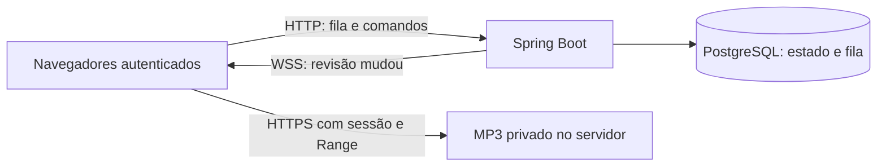

# Plano — fila de música compartilhada

Status: planejamento, sem player implementado. O usuário confirmou **fila compartilhada na sala**, com a mesma música para todos. Cada cliente mantém seu volume e pode deixar de ouvir sem pausar a sala. Não faz parte deste plano implementar transmissão a 60 fps.

## Opções gratuitas e recomendação

| Opção | Como funciona | Custos e limites | Decisão proposta |
|---|---|---|---|
| Biblioteca MP3 no próprio servidor | Administrador adiciona arquivos autorizados; navegadores recebem áudio autenticado e acompanham a fila | Sem assinatura ou API paga; usa disco e upload do servidor. Não oferece catálogo comercial pronto | **Base recomendada para a primeira versão** |
| YouTube por IFrame oficial | Cada navegador abre o vídeo original; o aplicativo sincroniza fila e comandos | Geralmente sem mensalidade de integração; conteúdo pode ter anúncios, restrição regional ou bloqueio de incorporação. Player precisa permanecer visível; não planejar extração de áudio | Melhor alternativa se a prioridade for escolher músicas por link; exige prova de conceito e revisão das regras vigentes |
| Rádio online HTTPS | Cada cliente abre a mesma estação, com HTTPS/formato compatível e CORS se passar pelo mixer Web Audio | Pode ser gratuita se o provedor permitir; não permite escolher qualquer faixa ou garantir a mesma posição ao vivo | Opção posterior simples para ouvir uma estação juntos |
| Navidrome/Jellyfin | Servidor de biblioteca pessoal separado | Software gratuito, mas exige biblioteca própria e mais um serviço para manter; não fornece músicas por si só | Não adicionar à stack inicial; avaliar se já houver uma biblioteca grande |
| Spotify Web Playback SDK | Cada cliente reproduz pela integração oficial e sua conta | Integração normalmente exige Premium e está sujeita às políticas do Spotify; não tratar como solução gratuita para o grupo | Fora do MVP gratuito |

Recomendação: começar com MP3 autorizados no servidor e fila sincronizada. Se escolher um catálogo por links como requisito principal, executar primeiro a prova de conceito YouTube descrita adiante; manter o núcleo de fila independente do provedor. Não existe promessa de catálogo comercial ilimitado, gratuito e sem restrições ao integrar um serviço de terceiros.

As páginas principais de YouTube/Spotify retornaram HTTP 403 neste ambiente em 26/10/2026. As condições de provedores acima são referências de arquitetura a revalidar antes de implementar essas integrações; não foram confirmadas cotas/preços atuais. As fontes MDN de foco, autoplay e Media Session foram consultadas pelo repositório oficial.

## Experiência prevista

- Card **Música da sala** no painel lateral, com faixa atual, progresso, fila recolhível e estado da reprodução. Preservar o espaço do chat e do player de tela.
- Todos os usuários ativos podem ouvir, enfileirar e remover suas próprias entradas pendentes. Administradores controlam iniciar/pausar, buscar posição, pular, reordenar, limpar e remover entradas de qualquer pessoa. Delegar um papel de DJ fica para outra entrega.
- **Ativar música neste navegador** é um gesto explícito por aba. `play()` bloqueado por autoplay mostra esse botão; não tentar contornar políticas. Entrar na sala ou recarregar não deve começar a tocar no máximo.
- Volume de música de 0–100% e mudo são locais, salvos por conta/navegador. Primeira ativação em 30%; nas próximas, restaurar o valor escolhido. Silenciar música não pausa a fila compartilhada.
- O volume geral e **Silenciar áudio** também atingem música. Mexer no volume da música não pode desfazer o mudo geral. Não reproduzir a própria música por uma segunda saída de áudio.
- Permitir ouvir música sem publicar microfone ou entrar na voz. Sair da voz não encerra música; logout encerra tudo. Testar duas abas: cada uma exige ativação explícita; avisar se outra aba local já estiver reproduzindo. Eleição automática de uma única aba audível pode ficar para uma melhoria posterior.
- Meta inicial de sincronização: diferença de posição de até **1 s**, após estabilização, com duas redes de teste. É meta de aceite a medir, não sincronismo de amostras para pessoas ouvindo lado a lado.

## Arquitetura e sincronização

Cada navegador reproduz o arquivo diretamente. LiveKit continua responsável por voz e tela: música não ocupa mais uma conexão da SFU e não exige mudar permissões de publicação. Não criar bot, Redis, outro servidor de mídia ou transcodificação no MVP.

1. O backend mantém o estado autoritativo: faixa, status, posição de referência, horário de início e revisão. Clientes não escolhem o horário do servidor.
2. Cada comando de fila/transporte traz `commandId` e a revisão esperada. Deduplicar por conta + commandId, sem compartilhar resultados entre usuários. Transação com lock do estado da sala, autorização e deduplicação; comando repetido não avança duas músicas. Revisão antiga → 409 com orientação para recarregar.
3. Publicar `{type:"music.changed", revision}` pelo `Events` **após commit**. Não enviar toda a fila pelo WebSocket, cujo buffer já é limitado. Cliente busca snapshot e ignora revisões antigas.
4. Snapshot inclui `serverTime`; estimar diferença de relógio com ida/volta e ancorar o avanço local em relógio monotônico. Buscar snapshot ao entrar, reconectar ou voltar de uma aba suspensa.
5. Calcular a posição esperada por posição-base + tempo decorrido. Na faixa seekable, corrigir desvios grandes; não reiniciar a música a cada evento. Definir limiares na prova de conceito, respeitando buffering e autoplay.
6. O backend avança ao fim pela duração validada da faixa e pelo relógio do servidor. `ended` do cliente é apenas sugestão: dois ouvintes não podem pular duas faixas. Aplicar avanço/sugestões sob o mesmo lock e revisão.
7. Em reinício do servidor, recuperar fila e posição e deixá-las pausadas até um administrador retomar. Desconexão de um ouvinte não altera a fila. Desativação/logout impedem novos comandos e downloads; dados já carregados no navegador não são revogáveis remotamente.

## Entregas em ordem

### 1. Prova de conceito e base de áudio

Executar depois da extração de ações do [plano de atalhos](SHORTCUTS_PLAN.md). Extrair o estado de áudio para um provider compartilhado, acrescentando volume de música sem perder preferências existentes.

O estado de saída/recepção deve funcionar também fora da voz: aplicar localmente sempre e chamar `/api/media/audio` somente quando houver identidade de mídia ativa.

O provider passa a ser dono do `AudioContext`, inicializado por gesto do usuário. Entregar esse contexto ao LiveKit por `webAudioMix` com contexto fornecido pela aplicação; o SDK não deve fechá-lo ao sair da voz. Usar um único caminho de reprodução para música, com ganho que respeite volume local, saída geral e recepção silenciada. Os tracks remotos continuam controlados por `RemoteAudioTrack.setVolume`; não reintroduzir mudo apenas no elemento HTML.

Provar: música continua ao entrar/sair da voz; microfone e áudio da tela continuam independentes; logout destrói a reprodução e o contexto. Validar Safari/macOS e Chrome/Windows antes de considerar a base pronta.

### 2. Biblioteca privada de arquivos

Primeiro formato: MP3, sem transcodificação. Upload somente por administrador. Sugestão inicial configurável: 20 MiB por arquivo, até 15 minutos, 100 faixas e 500 MiB de biblioteca, com a primeira cota atingida prevalecendo. Limitar concorrência/frequência de importação.

- Novo volume de arquivos, separado do PostgreSQL; nada dentro de `/srv` público ou do Git. IDs gerados pelo servidor e nomes internos independentes do nome enviado.
- Validar conteúdo real, áudio e duração por inspeção limitada com `ffprobe`, instalado de fonte verificável na imagem. Executar sem shell, com formato MP3 explícito, apenas arquivo local, limite de tempo/saída/concorrência; não aceitar playlist ou URL remota. Isso inspeciona arquivos e não faz transcoding. Fixar dependência e revisar licença/build AMD64/ARM64 na execução.
- Receber em área temporária, conferir cotas, inspecionar e publicar arquivo completo com rename atômico. Só servir faixas marcadas prontas no banco. Recuperar temporários e órfãos após falhas sem apagar arquivos válidos.
- Há hoje limites de **16 KB em `frontend/Caddyfile` e no filtro `Security.java`**. Criar exceção estrita para o endpoint de upload, com limite maior contado no corpo real, inclusive sem Content-Length. Manter o limite das outras rotas. Autenticar administrador e validar CSRF antes de persistir/processar o arquivo.
- Servir `GET /api/music/tracks/{id}/audio` autenticado, com MIME correto, sem caminhos informados pelo cliente, `Range`/206/416 e conteúdo privado. Testar seek e revogação de acesso. Não aceitar URLs arbitrárias buscadas pelo backend.

### 3. Estado, fila e autorização

Criar a próxima migração Flyway disponível, após a de atalhos se ambos forem executados nessa ordem. Tabelas propostas: `music_tracks`, `music_queue`, `music_state` e deduplicação de comandos com retenção limitada. FKs para contas e faixas; ordem/revisão transacionais; limite inicial de 100 entradas e cinco pendentes por usuário.

API proposta, sempre autenticada:

| Caminho | Contrato inicial |
|---|---|
| GET /api/music/state | Snapshot de transporte, faixa, revisão e serverTime |
| GET /api/music/queue | Fila com limite/paginação |
| GET /api/music/tracks | Biblioteca pronta para enfileirar |
| POST /api/music/tracks | Upload MP3 por administrador; formato/limites documentados |
| DELETE /api/music/tracks/{id} | Administrador; tratar referências na fila/faixa atual |
| POST /api/music/queue | `{trackId, commandId, revision}` |
| DELETE /api/music/queue/{id} | Dono da entrada pendente ou administrador; `{commandId, revision}` |
| POST /api/music/commands | `{commandId, revision, action, positionMs?}`; transporte/admin |

Não confiar em conta, duração ou privilégios enviados pelo cliente. CSRF e limites em toda mutação; validar posições pelo tamanho real da faixa. Adicionar tratamento de `music.changed` ao WebSocket existente sem permitir comandos arbitrários de música no socket de entrada, que atualmente aceita somente `ping`.

### 4. Interface, operação e implantação

Implementar `MusicPlayer`, biblioteca, fila e controles compartilhados separados dos controles pessoais. Erro em uma faixa deve preservar voz/chat e oferecer remoção/pular; um único ouvinte com erro não pode derrubar ou avançar a sala inteira.

Atualizar backup/restore para incluir MP3 e manifesto de integridade além do dump, com formato versionado e suporte aos dumps antigos. Garantir consistência entre catálogo e arquivos durante backup; ensaiar restauração isolada. Atualizar volume Compose, permissões de disco, diagnóstico e guias de migração/retorno. Não usar `down -v` nem alterar segredos para ativar a música.

Dev e prd usam os mesmos endpoints; DuckDNS, certificados e portas permanecem. Para referência de banda: 16 ouvintes a 192 kbps representam aproximadamente **3,1 Mbps** de saída se todos forem remotos, além de overhead. Essa é a taxa equivalente de reprodução; downloads antecipados e seeks podem gerar picos maiores. Arquivos com bitrate maior consomem mais; não há redução automática pelo servidor no MVP.

## Testes e critérios de aceite

- Backend/PostgreSQL: permissões, conta desativada, CSRF, cotas, upload sem tamanho declarado, MP3 inválido, travamento do probe, revisão antiga, comandos repetidos, dois comandos concorrentes e avanço único ao fim.
- HTTP: sessão obrigatória, Range/seek, ausência de caminho público, rejeição de URL/playlist e tamanho/cotas; backup/restore recupera catálogo e arquivo correto.
- Playwright: dois ouvintes, fila compartilhada, pausa/seek/skip por administrador, volume independente, mudo geral, autoplay bloqueado, reconexão, troca de faixa e saída da voz sem cortar música. Medir saída de áudio, não apenas o estado dos botões.
- Layout: música + voz + transmissão simultâneas, desktop e 320×568/390×844/768×1024. Preservar as verificações de corte e sobreposição do campo de mensagem que já estão no CI.
- Relógio/rede: diferença de relógio entre clientes, atraso, buffering e aba suspensa; medir a meta de até 1 s após estabilização. Ouvinte bloqueado por autoplay não conta como reproduzindo.
- Teste humano com dois amigos em redes diferentes e macOS/Windows, incluindo volume, eco, captação de som e navegador em segundo plano. Depois medir carga progressiva; não declarar suporte a 16 ouvintes a partir de duas conexões sintéticas.
- CI da implementação aprovado antes de recomendar atualização do Mac. Registrar versão do navegador e distinguir teste local de resultado real do Actions.

## YouTube — alternativa de origem, não extração de áudio

Se escolhido como fonte principal, fazer uma prova pequena antes da implementação completa: aceitar somente ID/link de vídeo permitido, usar IFrame oficial visível, cada cliente carregar o vídeo e controlar posição pelo protocolo de fila. Não baixar/converter áudio, retransmitir pelo LiveKit ou esconder o vídeo para simular Spotify.

Verificar regras vigentes de incorporação, tamanho/visibilidade do player, controles, anúncios, autoplay e privacidade. Links diretos podem evitar uma integração de busca/Data API no início. Não prometer que toda música pode ser incorporada ou que anúncios/pausas serão idênticos entre clientes. Se o player externo não atingir a meta de sincronização, declarar essa limitação e não substituir a biblioteca MP3 silenciosamente.

O volume/mudo do YouTube deve ser aplicado pela API do próprio player; não tentar acessar o áudio interno do IFrame pelo Web Audio.

YouTube requer mudanças específicas de CSP, `frame-src`, origens de conexão e Permissions Policy, sem liberar hosts arbitrários. O IFrame está em outra origem: atalhos da página podem deixar de receber eventos quando ele tem foco; não contornar a separação de origens. Rever comportamento e aceite de atalhos antes de oferecer essa combinação.

## Referências

- [MDN: autoplay](https://developer.mozilla.org/en-US/docs/Web/Media/Guides/Autoplay), [fonte consultada](https://github.com/mdn/content/blob/main/files/en-us/web/media/guides/autoplay/index.md).
- [MDN: Media Session](https://developer.mozilla.org/en-US/docs/Web/API/MediaSession), [fonte consultada](https://github.com/mdn/content/blob/main/files/en-us/web/api/mediasession/index.md).
- [YouTube IFrame API](https://developers.google.com/youtube/iframe_api_reference) e [políticas do desenvolvedor](https://developers.google.com/youtube/terms/developer-policies): revalidar antes da integração; páginas bloquearam consulta neste ambiente.
- [Spotify Web Playback SDK](https://developer.spotify.com/documentation/web-playback-sdk/) e [exemplo oficial consultado](https://github.com/spotify/spotify-web-playback-sdk-example): confirmar requisitos comerciais antes de selecionar.
- [Navidrome](https://www.navidrome.org/) e [Jellyfin](https://jellyfin.org/): alternativas de biblioteca pessoal, sem serviço adicional contratado neste planejamento.
