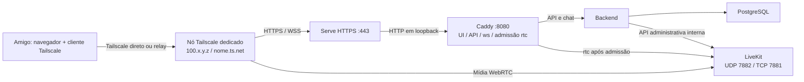

# Rede privada: comparação e plano de implementação

Data da pesquisa: **26/10/2026 (America/Sao_Paulo)**. Estado: **plano para execução futura**. Este documento não instala clientes, cria contas, altera ACLs ou ativa acesso remoto. Base do projeto: commit `f26f6c9`.

## Decisão

**Adotar Tailscale como primeira opção**, compartilhando somente um nó dedicado ao aplicativo com as contas pessoais dos amigos. Usar Tailscale Serve para HTTPS e o endereço Tailscale do nó para a mídia LiveKit. Manter Cloudflare Mesh como alternativa a avaliar se o piloto apresentar resultados ruins com retransmissores.

O motivo principal é a combinação de acesso restrito ao servidor, possibilidade de caminho direto e solução integrada para HTTPS. Não há evidência medida para afirmar que uma das redes terá melhor velocidade para todos os amigos. A escolha de Tailscale é de adequação ao projeto e facilidade operacional; desempenho depende do piloto.

Premissas: servidor no Mac M4 Pro/OrbStack já previsto no projeto, uso pessoal, até 16 conexões simultâneas, uma transmissão de tela, amigos dispostos a instalar cliente e entrar com sua conta. O login individual do aplicativo continua obrigatório. Nenhum serviço pago, domínio comprado ou recurso cloud será necessário para o piloto proposto; condições comerciais vigentes precisam ser conferidas antes da adesão.

## Pesquisa e limites da verificação

O proxy deste ambiente respondeu 403 para os sites Tailscale e Cloudflare, inclusive após tentativa com permissão ampliada. Foi possível ler os **repositórios oficiais** de código e documentação. As referências abaixo distinguem verificação própria de informações trazidas pelo proprietário.

| Critério | Tailscale | Cloudflare Mesh | Consequência neste projeto |
|---|---|---|---|
| Entrada dos amigos | Cliente e conta própria; compartilhamento do nó, conforme documentação indicada pelo proprietário [T1–T2] | Cliente inscrito na organização Zero Trust, com regras de inscrição e perfis [C2] | Tailscale encaixa no modelo de amigos com contas independentes |
| Caminho dos pacotes | Pode estabelecer caminho direto; usa retransmissão quando necessário [T3, T6] | Documentação confirma que todo tráfego passa pela rede Cloudflare [C1] | Direto pode reduzir desvio e dependência de relay; precisa medir por amigo |
| Transporte da mídia | Rede IP com transporte UDP/TCP; o modo kernel do container oferece interface para a SFU [T4] | TCP, UDP e ICMP explicitamente documentados [C1] | As duas são tecnicamente compatíveis com a necessidade de transporte do LiveKit |
| HTTPS no navegador | Serve implementa terminação TLS e proxy; certificados/nome `.ts.net` dependem da configuração da conta [T4–T5, T7] | Mesh fornece endereçamento/conectividade; o caminho de configuração consultado não entrega um certificado HTTPS do aplicativo [C1–C2] | Tailscale reduz trabalho de DNS/certificado; Cloudflare precisa de uma solução de HTTPS adicional |
| Gratuidade | Compartilhamento sem aumentar usuários da tailnet e disponibilidade em todos os planos: informação do proprietário com fontes oficiais, não revalidada aqui [T1–T2] | Guia oficial confirma que o Free é elegível [C2]. Limite comercial de 50 usuários informado pelo proprietário não foi revalidado | Não prometer gratuidade permanente, banda ilimitada ou capacidade de vídeo a partir de limites de usuários |
| Operação | Nó, compartilhamentos, política de acesso, Serve e clientes | Organização, inscrição, perfis, Split Tunnels, políticas Gateway e proxies TCP/UDP [C2] | Cloudflare oferece mais controles centralizados, com mais configuração para este grupo |
| Estado do produto | Recursos necessários aparecem no código oficial consultado; fixar release estável na implementação | A página consultada identifica Mesh como **Beta** [C3] | Considerar suporte e mudanças de comportamento no piloto Cloudflare |
| Garantia para 16 pessoas | Não comprovada | Não comprovada | A SFU continua enviando cópias da mídia para cada destinatário |

Não usar a comparação para concluir que Cloudflare é necessariamente mais lento: o roteamento pela sua rede pode melhorar determinados caminhos. Também não confundir Cloudflare Mesh com publicar o site por um túnel HTTP. O segundo, sozinho, não fornece a conectividade exigida pela mídia desta aplicação.

## Arquitetura escolhida para implementar

Criar um perfil **`CHAT_MODE=tailscale`**, mantendo os perfis `local` e `internet`. O nó compartilhado será um container Tailscale dedicado à stack, dentro do Linux do OrbStack. Isso evita compartilhar a identidade de rede do Mac pessoal e evita depender de publicar UDP no IP virtual do macOS.

O container Tailscale, Caddy web e LiveKit compartilharão o mesmo namespace de rede. PostgreSQL e backend permanecem na rede Docker interna. Nenhuma porta da aplicação será publicada no host nesse perfil.



**Serve transportará web e sinalização. A mídia usará as portas da SFU através da rede Tailscale.** Não habilitar Funnel, saída pela internet via exit node, anúncio de sub-redes ou SSH Tailscale para este perfil. Não é necessário TURN público para o desenho inicial: primeiro validar o transporte da rede privada e o fallback TCP existente.

Escolhas técnicas a implementar:

- Imagem oficial Tailscale com versão estável e digest fixados após validar ARM64 e AMD64. Os fontes consultados em `main` comprovam mecanismos, não substituem essa seleção de release.
- `TS_USERSPACE=false`, `/dev/net/tun` e somente as capabilities exigidas pela versão validada, começando por `NET_ADMIN`. Não usar `privileged`, rede do host ou socket Docker dentro do container. Confirmar suporte no OrbStack antes de prosseguir.
- `TS_STATE_DIR` persistente e `TS_AUTH_ONCE=true`. Estado contém identidade/chaves do nó; não versionar nem clonar para duas instâncias simultâneas.
- Nó não efêmero, pertencente ao usuário proprietário. Não usar tags/OAuth como requisito: confirmar as restrições atuais de compartilhamento de dispositivos antes de escolher o método de registro. O objetivo é compartilhar esse nó com contas externas.
- Autenticação inicial por fluxo interativo ou chave de uso único, não efêmera, sem tags. Se usar chave, a versão validada deverá suportar `TS_AUTHKEY=file:/run/secrets/...`, mecanismo presente no código oficial [T4]. Remover o segredo de bootstrap depois de persistir a identidade; não imprimir URLs de autenticação/chaves em logs públicos.
- LiveKit e web com `network_mode: service:tailscale`, sem `ports` ou configuração própria de `networks`. No serviço Tailscale, aliases internos `livekit` e `web` preservarão as referências atuais do backend/Caddy. Validar resolução real, evitando aliases duplicados em outros containers.
- Serve fará proxy para `http://127.0.0.1:8080`. Manter uma configuração declarativa `TS_SERVE_CONFIG`, com substituição do domínio real via `${TS_CERT_DOMAIN}`, conforme [T4]. Não adicionar `AllowFunnel`. HTTPS/certificados devem estar habilitados na conta.
- Caddy continua responsável por `/rtc`, `/rtc/*`, `/api/*` e `/ws`. O `forward_auth` de `MediaAdmission` e a substituição do JWT elevado por permissão inicial de microfone permanecem obrigatórios.
- `LIVEKIT_NODE_IP` será o IPv4 real atribuído ao nó. Manter `use_external_ip: false` e `enable_loopback_candidate: false`.
- No perfil Tailscale, restringir candidatos/mux ICE à interface `tailscale0` usando `rtc.interfaces.includes`, suportado pela dependência da versão LiveKit atual [L1]. Confirmar o nome real da interface e a negociação. Não mapear várias interfaces para o mesmo IP anunciado: isso pode reproduzir a falha de ICE corrigida em `f26f6c9`.
- Não usar o modo userspace padrão como substituto automático: o plano exige interface IP real no namespace da SFU, inclusive para UDP. Se TUN/kernel não funcionar, parar o piloto dessa arquitetura e usar um host/VM Linux com Tailscale nativo; uma nova topologia deve ser validada antes da migração de dados.

O container está atrás da rede/NAT do OrbStack. Isso pode dificultar conexão direta e aumentar uso de relay; a arquitetura não elimina essa possibilidade. Não abrir portas no roteador como passo automático para compensar o resultado. Avaliar `netcheck`, caminhos reais e a alternativa de host Linux antes de decidir.

### Configuração esperada

Exemplo ilustrativo, **não copiar como configuração válida**: descobrir nome completo e IP durante bootstrap.

```dotenv
APP_ORIGIN=https://chat-amigos.NOME-REAL.ts.net
LIVEKIT_PUBLIC_URL=wss://chat-amigos.NOME-REAL.ts.net
COOKIE_SECURE=true
LIVEKIT_NODE_IP=100.IP.REAL.DO_NO
LIVEKIT_INTERNAL_URL=http://livekit:7880
```

App e sinalização usam o mesmo domínio; não são necessários os dois domínios do perfil `internet`. O SDK já acrescenta o caminho `/rtc`; não mudar a URL base para um caminho duplicado. Usar o FQDN completo nos convites, inclusive para contas externas à tailnet. Verificar DNS e certificado a partir dessas contas, não só da conta proprietária.

O nome do certificado pode aparecer em registros públicos de Certificate Transparency. Escolher um nome neutro; HTTPS válido não torna o aplicativo acessível publicamente sem acesso de rede.

### Política de acesso

Permitir aos destinatários do compartilhamento somente estas portas no IP do nó:

| Destino no nó | Permitido aos amigos | Uso |
|---|---|---|
| TCP 443 | Sim | HTTPS/WSS via Serve |
| UDP 7882 | Sim | Mídia ICE principal |
| TCP 7881 | Sim | Fallback ICE |
| TCP 7880 | Não | Controle/sinalização direta da SFU; acesso somente pela rede Docker interna |
| TCP 8080, 5432, 22 e demais portas | Não | Não fazem parte do acesso dos amigos |

Gerar um exemplo de grants/ACL para o nó específico, com origem de usuários compartilhados (`autogroup:shared`, se confirmado na sintaxe vigente), protocolos e portas explícitos. Revisar também regras existentes: permissões Tailscale são aditivas; uma regra ampla anterior pode manter acesso que se pretendia bloquear. Não substituir cegamente toda a política da tailnet do proprietário.

Conferir a política com dois usuários externos e um usuário sem compartilhamento. Não autorizar acesso à LAN, a outros dispositivos do proprietário ou a serviços de outros amigos. Não tratar headers de identidade do Serve como substitutos do login, CSRF e permissões do aplicativo.

## Etapas para a execução futura

### 1. Preparação e piloto de rede — antes de alterar a stack em uso

1. Conferir na conta os termos/limites atuais, compartilhamento de máquina com usuários externos, HTTPS e expiração da chave do nó. Não assinar um plano pago como parte automática da implementação.
2. Registrar versão do OrbStack, Docker/Compose, arquitetura e cliente Tailscale dos participantes. Validar imagem ARM64, `/dev/net/tun` e capabilities mínimas em ambiente descartável.
3. Registrar um nó dedicado e persistente; obter IPv4 e FQDN. Ativar MagicDNS/HTTPS conforme exigido pela conta. Configurar somente as permissões necessárias antes de compartilhar.
4. Compartilhar com duas pessoas em redes distintas, preferencialmente uma em rede residencial e outra em rede móvel. Cada uma aceita com a própria conta; não convidá-las como membros da tailnet por engano.
5. Validar alcance do nó, tipo de conexão com `tailscale status`, `tailscale ping` e `tailscale netcheck`. Fazer medições nos participantes e no servidor. Registrar apenas resultados sanitizados, sem identidade pessoal, tokens ou mapas completos da rede.
6. Validar Serve/HTTPS com um endpoint de teste e validar UDP/TCP reais da stack descartável. A etapa só passa quando a conta externa acessa web e mídia e a conta não autorizada é bloqueada.

**Saída:** topologia aprovada no Mac real ou decisão explícita de usar host Linux. Cloud Codex sem acesso ao Mac não pode concluir esse aceite por inferência.

### 2. Adicionar o perfil ao projeto

| Arquivo a criar/alterar | Trabalho previsto |
|---|---|
| `infra/compose/tailscale.yml` | Serviço dedicado, estado persistente, TUN/capabilities, aliases internos e namespace compartilhado; remover publicações de portas por `!override []` |
| `infra/compose/tailscale-serve.json` | HTTPS para o FQDN real, proxy para loopback 8080, sem Funnel; validar no release fixado |
| `scripts/render-config.mjs` | Aceitar `tailscale`; validar origem HTTPS/WSS, cookie seguro, domínio real e IP descoberto; selecionar interface ICE somente nesse perfil |
| `scripts/compose.sh` | Selecionar exatamente um perfil; incluir `tailscale.yml`; rejeitar combinação automática com overlay público/TURN |
| `scripts/tailscale-init.sh` | Bootstrap em duas fases: identidade primeiro, configuração do app depois. Validar IP/FQDN antes de subir web/backend/SFU; preservar credenciais existentes |
| `scripts/up.sh` | Fluxo do novo modo, prontidão do nó antes da SFU e tratamento explícito de configuração ausente |
| `.env.example` / `.gitignore` | Explicar variáveis, ignorar segredos de bootstrap/estado/relatórios; nunca incluir uma chave real |
| `scripts/diagnose.sh` ou `scripts/diagnose-tailscale.sh` | Saúde da stack, Serve e estado resumido de caminho direto/relay, sem dumps de credenciais |
| `scripts/check.sh` | Evitar que uma verificação local regenere a configuração de uma stack Tailscale em uso; usar ambiente de teste separado ou recusar a operação conflitante |
| `frontend/tests/ice.spec.ts` e suporte de testes | Permitir destino de mídia explícito, separado da URL HTTPS, mantendo defaults locais; validar STUN assinado nos dois protocolos |
| CI, `README`, `NETWORKING`, `LOCAL_SETUP`, `OPERATIONS`, `TESTING`, `STATUS` | Documentar novo modo, bootstrap, atualização, limites e evidências executadas |

No bootstrap, iniciar apenas o nó após preparar os segredos locais. Após autenticação, descobrir IP/FQDN, validar e gravar a configuração, então iniciar a aplicação. Não usar IP provisório ou localhost como candidato de mídia remoto. Não criar dependência circular entre autenticação do nó, geração da configuração e healthchecks do backend.

Reinicializar ou recriar o container Tailscale pode invalidar o namespace usado por web/LiveKit. O script de atualização deverá coordenar a recriação desses três serviços. `depends_on` sozinho não garante recuperação depois de toda falha em runtime. Preservar o volume de identidade para evitar novo dispositivo/IP/convites a cada atualização.

### 3. Testes de integração e de acesso

- Executar lint/build e os **oito testes atuais**, preservando áudio bidirecional, recusa de microfone, chegada/parada de tela, ausência de participantes fantasmas, STUN autenticado UDP/TCP e redução de permissão do JWT.
- Testar o novo gerador com configurações válidas e inválidas: origem incompatível, cookie inseguro, IP inexistente, nó deslogado e mistura de perfis. As falhas devem interromper o startup antes de publicar o serviço.
- Validar `compose config -q` em cada perfil; inspecionar somente metadados de portas/redes para confirmar que o novo modo não publica portas no Mac. Nunca imprimir configuração expandida com segredos.
- No caminho HTTPS real, testar cookie Secure, CSRF, Origin, login/logout, chat WebSocket e admissão `/rtc`. Verificar headers entre Serve e Caddy e limites de requisição. Manter testes de JWT elevado e sessão expirada.
- De uma conta compartilhada, comprovar que 7880/8080/5432/22 não são alcançáveis, mesmo com token LiveKit válido. Comprovar que a aplicação não está acessível de uma rede sem Tailscale ou sem compartilhamento.
- Revogar um compartilhamento durante chamada e comprovar perda de acesso. Separadamente desativar a conta do aplicativo e comprovar invalidação da sessão/mídia. Os dois controles são independentes.
- Testar restart da stack, recriação do nó com estado preservado, indisponibilidade temporária da rede, expiração/reauth do nó e retomada após suspensão do Mac. Documentar quando é necessário entrar novamente na voz.
- Confirmar captura de microfone/tela em navegador/SO reais. Áudio do sistema/jogo no macOS tem limitações próprias; a rede privada não as resolve.

CI normal deve continuar independente de conta Tailscale. Fazer validações estruturais/configuração e regressões locais nesse CI. O teste com compartilhamento entre contas é um procedimento manual ou job privado iniciado explicitamente, com segredos protegidos e limpeza de fixtures. Não colocar chaves duradouras da rede real em pipelines de PRs externos.

### 4. Aceite de desempenho

Medir progressivamente **2, 4, 8 e 16 participantes**, por pelo menos 20 minutos em cada carga aprovada. Começar em 720p/30 fps, teto atual de 4 Mbit/s, com uma tela e fala simultânea representativa. Se reprovar, medir novamente o preset existente de 480p/15 fps/1 Mbit/s; registrar qual perfil atende qual grupo.

Coletar por participante: caminho Tailscale direto/DERP/outro relay quando aplicável, RTT/perda/jitter WebRTC, bytes recebidos, frames decodificados, resolução/FPS e interrupções. No servidor: upload/download, CPU, memória, quedas/reconexões e saturação do link. Registrar versão, rede de origem, duração e quantidade de falantes para permitir comparação.

**Duas camadas diferentes:** `getStats()` indicando UDP mostra o transporte ICE dentro da rede privada. Isso não comprova conexão Tailscale direta; o pacote UDP interno pode atravessar um retransmissor. Conferir ambos os diagnósticos.

Metas iniciais do projeto, a validar com a experiência do grupo, **não garantias dos fornecedores**:

- Nenhuma desconexão inesperada durante a janela de 20 minutos.
- Áudio compreensível sem cortes recorrentes; RTT p95 até 150 ms, jitter p95 até 30 ms e perda agregada até 1% por receptor como referência inicial.
- No preset 720p/30, média de pelo menos 20 frames decodificados/s por receptor durante cena em movimento, sem congelamentos recorrentes acima de 1 s. Uma tela estática não serve para esse ensaio de FPS.
- Pelo menos 25% de margem no upload sustentado medido; sem saturação persistente de CPU ou memória. Ajustar limites dos containers somente com evidência de gargalo.

**Banda:** com uma tela de 4 Mbit/s e 15 espectadores, a SFU envia aproximadamente **60 Mbit/s apenas de vídeo**, antes de áudio, overhead e retransmissões. VPN/mesh não elimina esse fan-out. Se o preset reduzido usar 1 Mbit/s, o vídeo fica perto de 15 Mbit/s nessa mesma hipótese. São contas de planejamento; bitrate efetivo e recursos de adaptação devem ser medidos. Não anunciar suporte para 16 pessoas após testar apenas duas.

### 5. Convites e operação

Após o aceite, produzir um guia curto para os amigos: instalar cliente oficial, autenticar na própria conta, aceitar compartilhamento, abrir o FQDN HTTPS, entrar no app e conceder permissões de microfone/tela. Fazer onboarding gradual; o proprietário cria as contas do app pelo fluxo existente.

O runbook do proprietário deve cobrir criação/revogação de compartilhamento, desativação de conta, backup do PostgreSQL, preservação segura da identidade do nó, atualização coordenada, renovação de HTTPS e expiração de autenticação do Tailscale. O Mac precisa permanecer ligado, com OrbStack ativo e preferencialmente conectado por cabo durante encontros.

Evitar operar Tailscale e Cloudflare One Client simultaneamente na prova comparativa: faixas privadas, rotas e DNS podem conflitar. Testar cada alternativa separadamente, com plano de retorno das configurações do cliente.

### 6. Rollback

Antes da ativação, guardar `.env` e configurações anteriores com acesso restrito e executar backup verificável do banco. Fazer a mudança em janela sem chamadas.

Se o piloto falhar, revogar compartilhamentos de teste, parar Serve/nó e remover os containers do perfil Tailscale **sem remover volumes**. Restaurar o perfil `local` e seus valores de localhost/cookie, regenerar a configuração e recriar web/LiveKit para sair do namespace compartilhado. Confirmar chat/dados e os testes locais. Não usar `down -v`.

Preservar o estado do nó apenas se houver intenção de retomá-lo; ao encerrar definitivamente, revogar o dispositivo e remover credenciais locais de forma deliberada. Não restaurar o mesmo estado em duas máquinas simultâneas. Nenhuma alteração de schema do banco faz parte deste plano.

## Quando reconsiderar Cloudflare Mesh

Executar um piloto comparável se Tailscale usar relay em participantes importantes e não atingir as metas, mesmo no preset reduzido e com upload/CPU suficientes. Antes disso, distinguir gargalo do Mac, Wi-Fi, ISP, codec e SFU de problema do caminho da VPN.

O piloto Cloudflare deve usar os mesmos participantes, máquina, conteúdo, horário aproximado, codec e bitrate. Implementar inscrição restrita, Split Tunnels para a faixa Mesh, perfil MASQUE conforme documentação atual, políticas de portas e HTTPS válido antes dos testes de mídia. A documentação confirma suporte ao Free, mas a oferta comercial e os limites devem ser conferidos no dia. O número de nós do limite técnico não equivale ao limite de usuários do plano.

Trocar a recomendação somente se esse ensaio mostrar melhoria útil e operação aceitável. Não há evidência atual que justifique migrar para Cloudflare antecipadamente, nem promessa de que seus retransmissores resolverão um upload doméstico insuficiente.

## Entregas e conclusão da implementação futura

Sequência sugerida de commits: (1) perfil e bootstrap; (2) Serve, ACL de exemplo e operação; (3) testes e diagnóstico; (4) documentação com evidências do Mac e redes externas. Se uma etapa revelar incompatibilidade, registrar e corrigir a arquitetura antes da próxima.

Concluído somente quando: perfil reprodutível sem segredos versionados; HTTPS válido para conta externa; mídia real nos dois sentidos; acesso restrito às portas previstas; revogação e reinício testados; carga aprovada registrada; rollback exercitado. O número máximo anunciado será o efetivamente medido.

## Fontes

Fontes oficiais consultadas via GitHub, com revisão fixada:

- **[C1] Cloudflare Mesh — conceitos:** [fonte oficial](https://github.com/cloudflare/cloudflare-docs/blob/8c30c8b4876fd857bd049ea3525fa463a5015a02/src/content/partials/cloudflare-one/mesh/pages/concepts.mdx). Confirma TCP/UDP/ICMP, tráfego pela Cloudflare, endereçamento e MASQUE. [Página publicada](https://developers.cloudflare.com/mesh/concepts/).
- **[C2] Cloudflare Mesh — configuração:** [fonte oficial](https://github.com/cloudflare/cloudflare-docs/blob/8c30c8b4876fd857bd049ea3525fa463a5015a02/src/content/partials/cloudflare-one/mesh/pages/get-started.mdx). Confirma elegibilidade do Free e requisitos de organização, inscrição, perfis e Gateway. [Página publicada](https://developers.cloudflare.com/mesh/get-started/).
- **[C3] Cloudflare Mesh — identificação Beta:** [metadados oficiais](https://github.com/cloudflare/cloudflare-docs/blob/8c30c8b4876fd857bd049ea3525fa463a5015a02/src/content/docs/cloudflare-one/networks/connectors/cloudflare-mesh/index.mdx).
- **[T4] Tailscale — containerboot:** [fonte oficial](https://github.com/tailscale/tailscale/blob/eba00ab3638983a0c274e2ea271476c80fcd8acf/cmd/containerboot/main.go). Descreve modo kernel/userspace, autenticação por arquivo, persistência e configuração do Serve.
- **[T5] Tailscale — implementação Serve:** [fonte oficial](https://github.com/tailscale/tailscale/blob/eba00ab3638983a0c274e2ea271476c80fcd8acf/ipn/ipnlocal/serve.go). Terminação TLS, proxy e distinção de Funnel.
- **[T6] Tailscale — transporte magicsock:** [fonte oficial](https://github.com/tailscale/tailscale/blob/eba00ab3638983a0c274e2ea271476c80fcd8acf/wgengine/magicsock/magicsock.go). Implementação de caminhos UDP e DERP; não estabelece um SLA de desempenho.
- **[L1] LiveKit mediatransportutil — interfaces RTC:** [fonte oficial](https://github.com/livekit/mediatransportutil/blob/2e8ba344fca3/pkg/rtcconfig/config.go) e [aplicação ao mux ICE](https://github.com/livekit/mediatransportutil/blob/2e8ba344fca3/pkg/rtcconfig/webrtc_config.go), versão referenciada pelo LiveKit 1.9.12 utilizado no projeto.

Fontes oficiais indicadas pelo proprietário ou a consultar novamente na implementação; páginas indisponíveis neste ambiente:

- **[T1]** [Inviting vs sharing](https://tailscale.com/docs/reference/inviting-vs-sharing): distinção entre membro da tailnet e destinatário de compartilhamento.
- **[T2]** [Sharing](https://tailscale.com/docs/features/sharing): requisitos, planos e restrições atuais do compartilhamento.
- **[T3]** [Connection types](https://tailscale.com/docs/reference/connection-types): caminhos diretos e retransmissão.
- **[T7]** [Tailscale Serve](https://tailscale.com/docs/features/tailscale-serve) e [certificados HTTPS](https://tailscale.com/docs/how-to/set-up-https-certificates): procedimento vigente para nomes/certificados e pré-requisitos da conta.
- [Tailscale pricing](https://tailscale.com/pricing) e [Cloudflare Zero Trust plans](https://www.cloudflare.com/plans/zero-trust-services/): confirmar oferta comercial e limites de usuários no momento do piloto.
