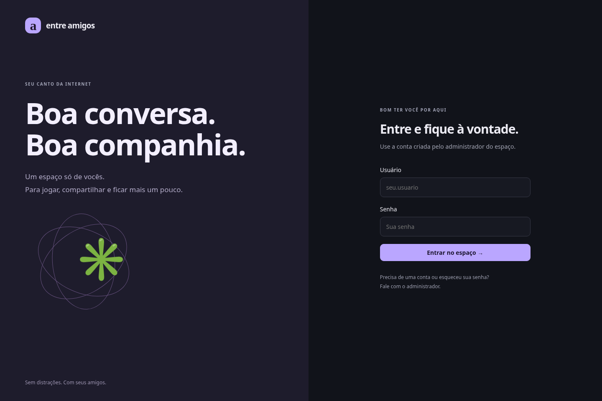
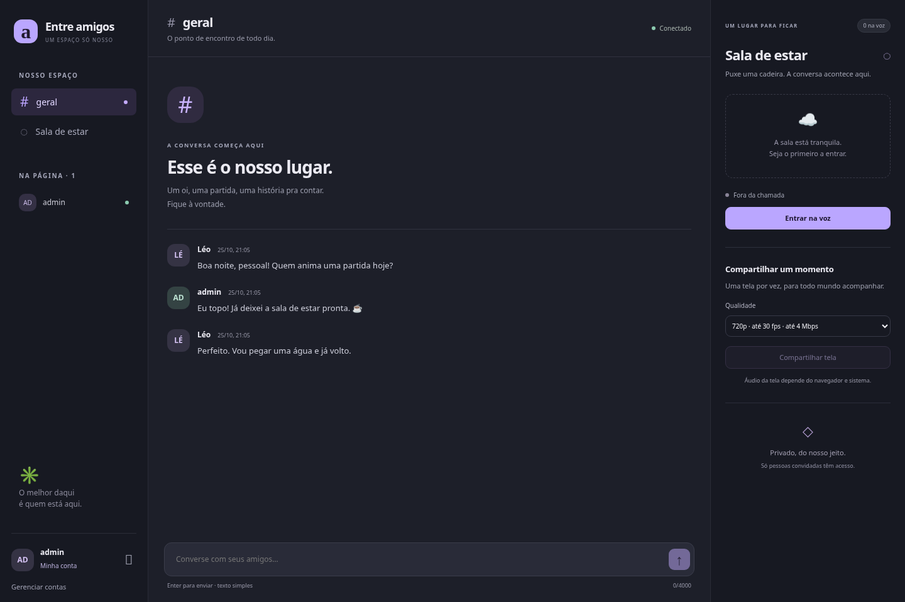

# Guia de uso

1. Peça uma conta ao administrador; não há cadastro público nem recuperação por e-mail. Entre com usuário e senha. O administrador nunca precisa saber sua nova senha após você alterá-la.
2. **Layout.** A barra de ícones à esquerda (embaixo, no celular) abre Canais, Sala, Conversa, Nova conversa ao lado, Membros, Restaurar layout, Gerenciar contas (admin), Minha conta e Sair. Ao lado fica o painel **Canais** (pode ser redimensionado, movido ou fechado como os outros; o primeiro ícone o mostra ou esconde): **Membros**, **Configurações** (sua conta), **Gerenciar contas** (admin), canais de texto, canais de voz com quem está em cada sala (selo **AO VIVO**, mic desligado, áudio silenciado) e, embaixo, seu nome com atalhos de microfone, áudio e sair. No celular e em telas de até 900 px, ele vira uma gaveta aberta pelo botão de menu. O resto da tela são painéis como num editor: **Sala de estar** (chamada e transmissão), **# geral**, **Membros**, **Minha conta** e **Gerenciar contas**. Arraste uma aba para outra posição ou para a borda de outro painel para dividir a tela; arraste a divisória para redimensionar; duplo clique na aba maximiza/restaura. **Nova conversa ao lado** abre outra vista de #geral; **Restaurar layout** volta ao padrão. Fechar o painel da sala não encerra a chamada. O layout fica salvo neste navegador, separado para telas de até 900 px (painéis viram abas) e largas.
3. Escreva em **geral**, Enter ou botão enviar; o botão de emoji insere emojis no texto. Mensagens seguidas da mesma pessoa em até 5 minutos aparecem agrupadas, com separador por dia. “Aguardando confirmação” significa que o servidor ainda não confirmou persistência. Tentar novamente reutiliza o mesmo identificador. Recarregar a página pode perder rascunhos ainda não confirmados; histórico confirmado permanece.
4. **Membros** mostra quem está com o espaço aberto; quem está na voz aparece na barra lateral e nos cartões da sala. Clique **Entrar na voz** (ou na sala, na barra lateral) e conceda permissão de microfone; se negar, você pode continuar conversando por texto e ouvindo a sala.
5. Na barra da chamada use **Microfone** (ligar/desligar), **Áudio** (silenciar a chamada) e **Sair**. Silenciar a chamada corta as vozes dos participantes e desliga seu microfone; ao voltar a ouvir, o microfone retorna ao estado anterior. A transmissão e o bot de música continuam tocando com seus controles de volume independentes. Use **Silenciar transmissão** para cortar só a live e volume zero para silenciar só a música. **Volume de saída** é o volume geral e continua afetando todas essas fontes. A seta ao lado de Microfone abre o seletor de entrada, **Volume do microfone** (0–200%), **Volume de saída** (0–100%), **Efeitos sonoros** (0–100%, padrão 60%; 0 desliga) e **Supressão de ruído**. Efeitos tocam ao entrar e sair da chamada (também quando outra pessoa entra ou sai, exceto com o áudio silenciado) e ao ligar/desligar o microfone ou o áudio. O volume de cada participante (0–200%) fica no botão de volume do cartão e em Configurações → Voz e áudio. Cartões mostram mic desligado, áudio silenciado e um anel verde em quem fala; o estado de áudio silenciado pode demorar até 5 s. Ajustes são pessoais, salvos neste navegador por conta; acima de 100% pode distorcer. A supressão Forte (padrão) usa RNNoise local; Leve usa o recurso do navegador, e Desligada permite comparar. Cancelamento de eco continua ativo. Se o filtro forte não puder iniciar, o microfone continua sem ele. A qualidade depende do dispositivo e precisa ser avaliada com ruído real.
6. Entre na voz e clique **Compartilhar**. A seta ao lado escolhe a qualidade antes ou durante a transmissão: **1080p 60 fps**, **1080p 30 fps**, **720p** ou **480p**. Opções desativadas dependem dos tetos do servidor (`SCREEN_HEIGHT=1080`, `SCREEN_FPS=60`). Escolha a fonte no diálogo do navegador. São permitidas até 3 reservas simultâneas, uma por conexão. Se as vagas estiverem ocupadas, a quarta tentativa é recusada e sua captura é interrompida. A resolução recebida pode diminuir conforme a fonte e a rede.
7. Cada pessoa escolhe suas lives no seletor acima do vídeo: marque **Assistir live de …** para assistir uma, duas ou três ao mesmo tempo; desmarque para deixar de assistir. **Assistir todas** seleciona as lives disponíveis naquele momento e **Limpar seleção** remove todas. Não precisa transmitir nem ser administrador. O seletor também aparece antes de entrar na voz ou de o vídeo carregar; para receber a mídia, entre na voz, sem precisar compartilhar sua tela. Suas escolhas afetam somente seu navegador: as outras pessoas continuam com a seleção delas. Vídeo e áudio das lives desmarcadas deixam de ser assinados; vozes e música continuam com seus controles próprios. Uma nova live não é adicionada automaticamente à seleção manual. Se a única live escolhida encerrar, marque outra no seletor. Cada live remota mantém seu volume/mudo individual durante a chamada, mesmo ao alternar entre uma e várias telas; os volumes gerais de transmissão e saída continuam valendo. A grade acompanha o painel ou janela separada; em espaços estreitos as telas ficam empilhadas com rolagem. Use **Expandir** ou aumente o bloco para ganhar espaço. Tocar no cartão de quem transmite escolhe somente a live daquela pessoa. A transmissão aparece grande no centro da sala, com quem transmite, **AO VIVO**, resolução e quantos assistem. **Expandir/Compactar** maximiza o painel dentro da página; **Tela cheia** amplia o vídeo. **Abrir transmissão em outra janela** leva a transmissão para uma janela própria, que pode ir para outro monitor; o som continua sendo reproduzido pela chamada principal, com os controles independentes da transmissão. O navegador precisa permitir pop-ups do site. Ao passar o mouse aparecem **Silenciar transmissão** e o **Volume da transmissão**, que controlam somente o som dela. A própria prévia fica sem som para evitar eco. **Parar** (no lugar de Compartilhar) ou o botão nativo de captura encerra. Admin pode **Encerrar transmissão de …** no botão de mais opções, sem interromper as outras telas; uma ação antiga não encerra uma nova reserva. Compartilhamento de som só acontece se navegador/SO disponibilizar track de áudio; não é promessa de áudio de qualquer jogo no Mac.
8. **Minha conta** (avatar na barra de ícones, ou Configurações): foto de perfil (recortada e reduzida no navegador), **nick** (nome de exibição, muda na hora para todos, inclusive em mensagens antigas e na call), **usuário** de login (trocar encerra suas sessões; entre de novo com o novo nome), **Aparência** (cor primária e secundária ou um tema pronto, padrão “VGH Roxo”; a logo VGH acompanha as suas cores; só você vê; **Tamanho da interface**, automático aumenta em monitores grandes, salvo neste navegador), **Sons** (para entrar, sair, mutar e desmutar: um som pronto, nenhum ou um arquivo seu de até 300 KB e 5 s, salvo neste navegador; botão ▶ testa) e troca de senha. Admin pode criar, desativar/reativar e redefinir em **Gerenciar contas**. Senhas iniciais devem ser entregues por canal privado.

## Organizar a Sala de estar

Dentro da sala, os blocos **Transmissão**, **Pessoas** e **Música** têm sua própria organização. Arraste a alça **⠿** do cabeçalho para mudar a ordem; perto das bordas a sala rola automaticamente durante o movimento. A mesma alça aceita as setas do teclado, Home e End. **Organizar sala** mostra também os botões para mover acima/abaixo e os ajustes de altura e largura. No canto inferior direito de cada bloco, arraste **◢** para redimensionar; com foco nessa alça, ↑/↓ ajustam altura, ←/→ ajustam largura e Shift aumenta o passo da altura. Em painéis estreitos a largura fica inteira para manter os controles utilizáveis; as larguras escolhidas voltam quando há espaço.

**Separar transmissão** e **Separar música** abrem painéis independentes da Sala de estar. O bloco separado desaparece da sala, sem cartão de aviso ou espaço reservado; os demais blocos ocupam a área liberada. O botão de retorno fica no painel ou na janela da própria mídia. Ao retornar, a ordem e o tamanho anteriores são preservados. Arraste suas abas para mudar a posição, solte na borda de outro painel para dividir a tela e arraste as divisórias para redimensionar. No computador, Shift + arrastar a aba cria um painel flutuante dentro do site, com alças próprias de tamanho. Cada mídia também pode usar uma janela do navegador, pelos botões **Abrir transmissão em outra janela** e **Abrir música em outra janela**. **Trazer transmissão para a sala** e **Trazer música para a sala** devolvem o conteúdo e mostram a sala. Fechar uma janela do navegador devolve a mídia ao painel anterior; fechar um painel independente a devolve à sala. A busca, fila e volume da música permanecem, e mover a transmissão preserva o player. A página principal precisa continuar aberta para manter a chamada e o áudio. No celular, os painéis independentes aparecem como abas.

Em **Pessoas**, **Tamanho dos cards** aumenta ou diminui os cartões e seus avatares. Arraste a alça de um cartão, ou use as setas, para colocar cada amigo na ordem que preferir. Entradas e saídas não apagam a ordem salva dos outros membros. Cards de abas adicionais da mesma conta usam posições separadas enquanto essas conexões estão presentes.

**Focar Transmissão** dá todo o espaço disponível ao vídeo; **Restaurar blocos** volta aos tamanhos e à ordem anteriores. O mesmo foco está disponível para Pessoas e Música. **Expandir** na transmissão continua ampliando o painel da sala e também prioriza o vídeo; tela cheia e janela separada continuam disponíveis. **Restaurar sala**, em Organizar sala, desfaz os ajustes internos. Tudo é pessoal e salvo neste navegador por conta, com configurações separadas para telas de até 900 px e telas largas. Mover, focar ou redimensionar os blocos não encerra a chamada nem reinicia o vídeo. A barra de chamada fica acessível enquanto o conteúdo da sala rola.

Permissão negada: confira permissões do site e do sistema; recarregue se necessário. Dispositivo ocupado: feche aplicativo que usa exclusivamente o microfone. Reconectando: aguarde; mensagens são recuperadas pelo histórico. Se a sessão expirou, entre novamente. Falha de mídia não apaga o chat.

Capturas históricas do Chromium Linux, anteriores aos novos controles de áudio e transmissão, com contas e mensagens sintéticas. Não são mockups nem prova de mídia funcionando.

[Captura em tela menor](images/mobile.png)

## Ajustes de outubro de 2026

- **Configurações** (avatar na barra de ícones) tem abas: Conta, Voz e áudio, Atalhos, Aparência e Sons. **Conta** reúne perfil, senha e a seção Segurança, com autenticador e sessões abertas. Em **Voz e áudio** ficam microfone, supressão de ruído, volumes e o **volume de cada pessoa** (também pelo ícone de volume no cartão da pessoa, na sala).
- **Supressão de ruído forte** (padrão): RNNoise roda no seu navegador para reduzir ruído de fundo, sem enviar o áudio a um serviço de filtragem. O resultado precisa ser testado com seu microfone e ambiente. A opção **Leve** usa o filtro do próprio navegador.
- **Silenciar a chamada também desliga o microfone**; ao voltar a ouvir, o microfone volta como estava. Transmissão e música mantêm seus próprios controles e continuam audíveis. Ligar o microfone enquanto silenciado volta a ouvir a chamada.
- Cartões e lista da sala mostram em vermelho quem está com o **mic desligado** e com o **áudio silenciado**; o anel verde de quem fala é medido no seu navegador e responde na hora.
- **Atalhos pessoais** (Configurações → Atalhos): cada pessoa grava os seus para mic, áudio, apertar para falar, som da transmissão e sair. Precisam de Ctrl, Alt ou ⌘ (F13–F24 podem ir sozinhas). Funcionam com a página em foco; **não funcionam dentro do jogo**.
- **Transmissão**: a qualidade pode ser trocada sem parar de transmitir; o cursor do mouse é escondido por padrão (desligue em Opções de transmissão para apresentações); o som desta página fica fora do áudio capturado quando o navegador permite, evitando que todos escutem a própria voz com atraso.
- Links nas mensagens abrem em outra aba. O chat abre no máximo duas vistas lado a lado.
- A conexão de voz usa o mesmo endereço do site, evitando a regra de bloqueadores como uBlock Origin e Brave para conexões de terceiros entre endereços DuckDNS. Outras regras ou bloqueios de WebRTC ainda podem impedir a conexão.
