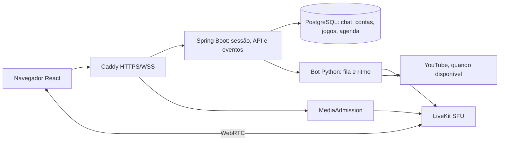

# Relatório de análise — Chat Friends / Entre amigos

Planejamento preparado em **29/10/2026**, fuso America/Sao_Paulo. Base fixa: [`d8fdd89a7f98`](https://github.com/dhtNEO/chat-friends/commit/d8fdd89a7f980f7cf03736c6b83682cc517aaf15), branch `main`. O checkout local estava limpo e correspondeu à base remota consultada.

## Conclusão executiva

O projeto tem uma base funcional importante e merece evolução incremental. Recomendo manter React/TypeScript, Spring Boot, PostgreSQL, LiveKit, Caddy e Compose, corrigir primeiro confiabilidade/acessibilidade e depois reorganizar a experiência em **Conversa, Sala, Jogos e Agenda**. Uma reescrita completa aumentaria o risco sobre o ciclo de mídia e as regras de concorrência já tratadas.

Foram inventariados **276 arquivos versionados**, avaliadas todas as grandes áreas e aprofundados os caminhos críticos de sessão, chat, mídia, música, jogos, agenda, deploy e testes. O pacote registra **22 achados e temas de melhoria** e **30 tarefas com specs individuais**. Isso é uma análise técnica e heurística abrangente do snapshot, não uma garantia de que todo defeito possível foi descoberto nem uma certificação de segurança/acessibilidade.

**Nenhuma interface foi implementada, nenhum arquivo versionado foi alterado e não houve commit, PR, issue, publicação, deploy ou operação de produção.** Foram criados apenas documentos de planejamento e artefatos locais de análise. Dependências locais foram preparadas para executar verificações, sem alteração de manifests/lockfiles.

## O produto e a arquitetura encontrados

Espaço privado para amigos, sem cadastro público: canal único de texto, sala de voz, uma tela autorizada, música compartilhada, perfis/atalhos, contas administradas, jogos com Coins virtuais e agenda interna. Limite funcional de até 16 conexões humanas de mídia; o bot ocupa participante adicional na SFU. Isso não comprova capacidade de hardware/rede para 16 pessoas.

| Área | Situação encontrada | Direção recomendada |
|---|---|---|
| Frontend | React 19.3.1, TS 6.0.3, Vite 8.3.5, Dockview, LiveKit, Three; componentes grandes e CSS por feature | Extrair responsabilidades, shell simples e visual consistente; preservar mídia estável |
| Backend | Java 25 / Boot 4.1.2, JDBC, monólito por domínio, SQL parametrizado | Manter arquitetura; contratos tipados, erros corretos e medição de locks/polls |
| Dados | PostgreSQL/Flyway, sessões JDBC, ledger e migrações históricas compatibilizadas | Migrações aditivas, testes dos históricos e recuperação completa |
| Autenticação | BCrypt, CSRF, cookies, MFA, reautenticação e invalidação | Preservar controles; melhorar feedback e falhas de dependência |
| Chat | Commit antes de ACK, UUID idempotente, WS + histórico por cursor | Fortalecer cursor de sincronização e estados de envio |
| Mídia | Lease, heartbeat, reconciliação, admissão restrita, áudio independente | Simplificar controles, manter ciclo de vida e decidir lacuna de múltiplas tracks |
| Música | Worker Python privado, fila limitada/temporária, extração restrita | Melhorar UX de falha/fila, scan da imagem e reset na recuperação |
| Jogos | Roleta, slots, blackjack, ritmo, locks e ledger autoritativo | Lobby consistente, medição de latência e budget de requisições |
| Agenda | Calendário interno, UTC, presença e versão de edição | Corrigir sobreposição mensal, completude e conflitos |
| Infra | Compose dev/prd, redes segmentadas, Caddy/DuckDNS, Terraform GCP | Preservar limites; validar recovery, WAN e ARM64 em etapas próprias |
| CI/testes | Suítes relevantes de integração, browser, scripts e bot | Complementar com a11y, performance, scan do bot e matriz de plataformas |
| Documentação | Extensa, com guias e evidência histórica | Separar atual/histórico e atualizar nomes, contratos e versões |

## O que já está bem resolvido

- Mensagens têm UUID de idempotência, ordenação de commit serializada e recuperação HTTP; não propor duplicar infraestrutura para substituir isso.
- Mídia tem identidade por sessão/aba, revogação antes de nova concessão, lease persistida e sinalização com token restrito.
- A interface mantém elementos de mídia durante movimentação de painéis; janelas destacadas e controles de áudio independentes já existem.
- MFA de administradores em prd, privilégios separados do banco, CSP e segmentação não devem ser enfraquecidos durante o redesign.
- Jogos mantêm Coins e liquidações no servidor; agenda protege concorrência de edição.
- Existem lazy loading para cenas 3D, fallback HTML, regras de movimento reduzido em várias áreas e testes que exercitam comportamentos reais. As melhorias devem completar essas bases.

Referências principais: [docs/ARCHITECTURE.md](https://github.com/dhtNEO/chat-friends/blob/d8fdd89a7f980f7cf03736c6b83682cc517aaf15/docs/ARCHITECTURE.md), [docs/SECURITY.md](https://github.com/dhtNEO/chat-friends/blob/d8fdd89a7f980f7cf03736c6b83682cc517aaf15/docs/SECURITY.md), [frontend/src/Voice.tsx](https://github.com/dhtNEO/chat-friends/blob/d8fdd89a7f980f7cf03736c6b83682cc517aaf15/frontend/src/Voice.tsx), [backend/src/main/java/com/chatfriends/Chat.java](https://github.com/dhtNEO/chat-friends/blob/d8fdd89a7f980f7cf03736c6b83682cc517aaf15/backend/src/main/java/com/chatfriends/Chat.java).

## Método e limites

Leitura do inventário completo, manifests, arquitetura, segurança, status e testes; revisão aprofundada de fontes selecionadas e buscas transversais; build/lint; execução de testes existentes; inspeção manual por screenshots e probes no Chromium com dados de demo. Foram consultadas fontes externas primárias de acessibilidade, layouts adaptativos, desempenho e SDK, além de pesquisa UX da NN/g. A lista de arquivos não significa leitura linha a linha de todos os 276 artefatos, binários ou dependências.

Os termos usados abaixo têm significado distinto: **confirmado** é observável no código ou em reprodução descrita; **risco** é uma hipótese tecnicamente sustentada que exige validação; **heurística** é recomendação de UX ainda sem estudo com usuários. Prioridade mede impacto e ordem de trabalho, não CVSS.

## Verificações executadas nesta análise

| Verificação | Resultado e limite |
|---|---|
| Lint do frontend | Passou |
| TypeScript + build Vite | Passou; warning de chunk acima de 500 kB |
| Playwright selecionado | **31 passaram**: auth, demo, games-demo, outlook-demo, party-demo, rhythm-timing; APIs simuladas/demos, não backend integrado |
| Bot Python | **30 passaram** com dependências fixadas em ambiente temporário; sem consulta real ao YouTube |
| Scripts Node | **28 passaram**; mocks locais, sem conta DuckDNS |
| Probes de navegação | Desktop 1440×900, mobile 390×844 e 320×740; sem pageerror nesses probes; drawer Escape reproduzido |
| GET /me=503 inicial | Confirmado login sem alerta em frontend normal com API simulada |
| Git | Nenhuma alteração versionada após análise |

As primeiras tentativas encontraram dependências locais incompletas e restrição do sandbox a sockets. Foram corrigidas na preparação do ambiente; não classificadas como bugs do projeto. Uma tentativa de auth contra modo demo era configuração inadequada e foi descartada: a execução final usou frontend normal com mock HTTP e demos isolados. Java/PostgreSQL e mídia real não foram reexecutados; números históricos de STATUS não são apresentados como resultados atuais.

## Achados e rastreabilidade

### E01 — Menu mobile não fecha com Escape

**Confirmado no demo · P1.** Abrir menu em 390×844, pressionar Escape: .drawer-open permanece. Não há handler/foco modal no drawer.

Evidência: [frontend/src/App.tsx:592](https://github.com/dhtNEO/chat-friends/blob/d8fdd89a7f980f7cf03736c6b83682cc517aaf15/frontend/src/App.tsx#L592). Tarefas: **T06 T27**.

### E02 — Ações mobile ficam fora da primeira área visível

**Confirmado no demo · P1.** Em 390 px, Agenda/Outlook, restaurar layout, administração, configurações e sair ficam à direita; em 320 px, Jogos também. A barra é rolável: não é perda absoluta de acesso, mas baixa descoberta e excesso de destinos.

Evidência: [frontend/src/App.tsx:593](https://github.com/dhtNEO/chat-friends/blob/d8fdd89a7f980f7cf03736c6b83682cc517aaf15/frontend/src/App.tsx#L593). Tarefas: **T08 T27**.

### E03 — Indisponibilidade inicial parece sessão deslogada

**Confirmado com API simulada · P1.** GET /api/me=503 na abertura mostra login e nenhum role=alert. load() faz setMe(null) para qualquer falha quando afterLogin=false.

Evidência: [frontend/src/App.tsx:65](https://github.com/dhtNEO/chat-friends/blob/d8fdd89a7f980f7cf03736c6b83682cc517aaf15/frontend/src/App.tsx#L65). Tarefas: **T02**.

### E04 — Falha interna pode virar 401

**Confirmado por leitura · P1.** Security captura Exception na validação de conta/sessão/budget e responde 401; uma falha de banco pode provocar logout no cliente. api() também não padroniza exceções de rede fora do login.

Evidência: [backend/src/main/java/com/chatfriends/Security.java:113](https://github.com/dhtNEO/chat-friends/blob/d8fdd89a7f980f7cf03736c6b83682cc517aaf15/backend/src/main/java/com/chatfriends/Security.java#L113). Tarefas: **T02 T22**.

### E05 — Cursor do chat pode avançar sobre recuperação incompleta

**Risco derivado do código · P1.** merge avança latest pelo maior ID de HTTP ou WS; catchUp falho apenas mostra erro. Se chegarem mensagens novas antes da recuperação bem-sucedida, o cursor da próxima conexão pode saltar uma lacuna. Falta reprodução integrada com injeção de falha.

Evidência: [frontend/src/App.tsx:324](https://github.com/dhtNEO/chat-friends/blob/d8fdd89a7f980f7cf03736c6b83682cc517aaf15/frontend/src/App.tsx#L324). Tarefas: **T03**.

### E06 — Envio pendente não distingue processamento e rejeição

**Confirmado por leitura · P1.** pending armazena UUID/corpo, send apenas informa erro e Tentar novamente aparece sempre. Rascunho vive em ChatView; emoji é inserido por setBody sem truncagem pelo limite do input.

Evidência: [frontend/src/App.tsx:900](https://github.com/dhtNEO/chat-friends/blob/d8fdd89a7f980f7cf03736c6b83682cc517aaf15/frontend/src/App.tsx#L900). Tarefas: **T04**.

### E07 — Histórico extenso sem ancoragem e janela de renderização

**Risco/limitação por leitura · P2.** Mensagens são acumuladas, ordenadas e renderizadas por map. Não há compensação explícita de scroll ao carregar anteriores; scroll anchoring do navegador pode mascarar o problema. Não foi medido o ponto de degradação.

Evidência: [frontend/src/App.tsx:927](https://github.com/dhtNEO/chat-friends/blob/d8fdd89a7f980f7cf03736c6b83682cc517aaf15/frontend/src/App.tsx#L927). Tarefas: **T05**.

### E08 — Escolha de texto do tema não garante contraste

**Confirmado por cálculo sobre código · P1.** textOn(#0ea5e9) retorna branco; contraste calculado com esse fundo é aproximadamente 2,77:1. O mesmo token participa de botões/gradientes. O contraste de cada estado renderizado ainda precisa de auditoria completa.

Evidência: [frontend/src/theme.ts:38](https://github.com/dhtNEO/chat-friends/blob/d8fdd89a7f980f7cf03736c6b83682cc517aaf15/frontend/src/theme.ts#L38). Tarefas: **T07**.

### E09 — Agenda mensal exclui eventos iniciados no mês anterior

**Confirmado por leitura · P1.** Filtro all compara mês/ano de startsAt. Um evento que cruza a meia-noite da virada aparece por dia, mas some da Agenda do mês seguinte.

Evidência: [frontend/src/Outlook.tsx:129](https://github.com/dhtNEO/chat-friends/blob/d8fdd89a7f980f7cf03736c6b83682cc517aaf15/frontend/src/Outlook.tsx#L129). Tarefas: **T15**.

### E10 — Agenda pode truncar resultados sem aviso

**Confirmado por leitura · P2.** Outlook.list aplica LIMIT 500, retorna lista sem hasMore/cursor e consulta participantes de todo o intervalo. O limite é uma proteção útil, mas não informa completude ao cliente.

Evidência: [backend/src/main/java/com/chatfriends/Outlook.java:130](https://github.com/dhtNEO/chat-friends/blob/d8fdd89a7f980f7cf03736c6b83682cc517aaf15/backend/src/main/java/com/chatfriends/Outlook.java#L130). Tarefas: **T15 T26**.

### E11 — Payload inicial concentrado

**Medido no build · P1.** Chunk principal 1.315,03 kB minificado / 349,44 kB gzip; CSS 221,76 / 30,31 kB. Jogos/agenda são importados estaticamente por App. Three e cenas já têm lazy loading: não é correto dizer que todo 3D carrega antecipadamente.

Evidência: [frontend/src/App.tsx:26](https://github.com/dhtNEO/chat-friends/blob/d8fdd89a7f980f7cf03736c6b83682cc517aaf15/frontend/src/App.tsx#L26). Tarefas: **T18**.

### E12 — Pontuação de ritmo depende da rede

**Risco de experiência a medir · P1.** PartyGames.note usa tempo de recebimento e +150 ms fixos; PartyClub estima offset por RTT de polling. Falta benchmark de sincronismo ouvido/visual/servidor em redes distintas.

Evidência: [backend/src/main/java/com/chatfriends/PartyGames.java:676](https://github.com/dhtNEO/chat-friends/blob/d8fdd89a7f980f7cf03736c6b83682cc517aaf15/backend/src/main/java/com/chatfriends/PartyGames.java#L676). Tarefas: **T14**.

### E13 — Polling pode exceder orçamento por IP

**Risco quantificado, carga pendente · P1.** Games 40 + Party 50 + Music 24 + Media 20 ≈134 req/min/cliente quando ativos. 16 no mesmo NAT ≈2.144, antes de heartbeats/notas, contra 1.800/IP/min. PartyClub é montado na aba Jogar. Confirmar cenário de uso/caching em carga.

Evidência: [backend/src/main/java/com/chatfriends/RequestGuard.java:46](https://github.com/dhtNEO/chat-friends/blob/d8fdd89a7f980f7cf03736c6b83682cc517aaf15/backend/src/main/java/com/chatfriends/RequestGuard.java#L46). Tarefas: **T19 T28**.

### E14 — Hierarquia, nomes e controles precisam de coesão

**Avaliação heurística · P2.** Inspeção em desktop/mobile: ícones + sidebar + abas, controles de organização visíveis no uso normal, calendário chamado Outlook sem integração Microsoft no código. Marca Entre amigos/VGH precisa de decisão, não de troca automática.

Evidência: [frontend/src/App.tsx:440](https://github.com/dhtNEO/chat-friends/blob/d8fdd89a7f980f7cf03736c6b83682cc517aaf15/frontend/src/App.tsx#L440). Tarefas: **T01 T08 T09 T10 T11 T12 T13 T16 T29**.

### E15 — Concentração de responsabilidades e lint incompleto

**Confirmado por inventário · P2.** App 1.248 linhas, Voice 1.320, PartyClub 1.069, GamesClub 933; PartyGames.java 880. Plugin de hooks está instalado, mas eslint.config.js inclui somente recommended do typescript-eslint. Tamanho é sinal de manutenção, não prova isolada de bug.

Evidência: [frontend/eslint.config.js:1](https://github.com/dhtNEO/chat-friends/blob/d8fdd89a7f980f7cf03736c6b83682cc517aaf15/frontend/eslint.config.js#L1). Tarefas: **T17**.

### E16 — Upload valida assinatura parcial de imagem

**Lacuna de robustez por leitura · P2.** Profiles.matches valida alguns bytes, sem decode completo ou limite de pixels. Arquivo máximo de 16 KB, autenticação, nosniff e tipos restritos já reduzem risco; não foi demonstrada exploração.

Evidência: [backend/src/main/java/com/chatfriends/Profiles.java:103](https://github.com/dhtNEO/chat-friends/blob/d8fdd89a7f980f7cf03736c6b83682cc517aaf15/backend/src/main/java/com/chatfriends/Profiles.java#L103). Tarefas: **T20**.

### E17 — Scanner de runtime omite music

**Confirmado por CI · P1.** Loop de imagens cobre backend, web, edge, LiveKit e db; serviço music não está incluído. Testes Python não substituem scan de pacotes/binários da imagem.

Evidência: [.github/workflows/ci.yml:127](https://github.com/dhtNEO/chat-friends/blob/d8fdd89a7f980f7cf03736c6b83682cc517aaf15/.github/workflows/ci.yml#L127). Tarefas: **T23**.

### E18 — Exceções não acompanham claramente a plataforma atual

**Divergência a reconciliar · P1.** Exceções Spring referem 6.2.19; pom declara Boot 4.1.2. Não foi gerado SBOM Java novo nesta análise. JOSE tem prazo 11/11/2026. Gate rejeita qualquer regra vencida, inclusive não utilizada. Não equivale a vulnerabilidade nova comprovada.

Evidência: [security/vulnerability-exceptions.json:1](https://github.com/dhtNEO/chat-friends/blob/d8fdd89a7f980f7cf03736c6b83682cc517aaf15/security/vulnerability-exceptions.json#L1). Tarefas: **T24 T29**.

### E19 — Restore não reinicia explicitamente o worker de música

**Confirmado por leitura; impacto a ensaiar · P2.** restore.sh para web/backend/livekit e deixa music fora. O worker mantém fila, token e reserva de ritmo em memória; o efeito após recuperação deve ser reproduzido em stack descartável.

Evidência: [scripts/restore.sh:7](https://github.com/dhtNEO/chat-friends/blob/d8fdd89a7f980f7cf03736c6b83682cc517aaf15/scripts/restore.sh#L7). Tarefas: **T25**.

### E20 — Exclusividade adversarial estrita não está comprovada

**Limitação já documentada · P1.** Participante malicioso com lease pode publicar múltiplas tracks até ser removido. Reconciliação nominal não garante zero sobreposição. Admissão, downscoping e revoke-before-grant já existem e devem ser preservados.

Evidência: [docs/SECURITY.md:31](https://github.com/dhtNEO/chat-friends/blob/d8fdd89a7f980f7cf03736c6b83682cc517aaf15/docs/SECURITY.md#L31). Tarefas: **T21**.

### E21 — Contratos, evolução de dados e documentação precisam de ciclo único

**Melhoria de governança técnica · P2.** Migrações históricas são tratadas cuidadosamente. Recomenda-se testar contratos por release, justificar índices por volume e definir retenção; planos e STATUS contêm várias fases de evolução. Não foi detectada corrupção de schema.

Evidência: [backend/src/main/java/com/chatfriends/MigrationHistory.java:1](https://github.com/dhtNEO/chat-friends/blob/d8fdd89a7f980f7cf03736c6b83682cc517aaf15/backend/src/main/java/com/chatfriends/MigrationHistory.java#L1). Tarefas: **T26 T29 T30**.

### E22 — Capacidade real e matriz de plataformas permanecem abertas

**Limite de evidência · P1.** A análise não executou suíte Java/PostgreSQL, WebRTC real, WAN, carga 16, Safari físico, restauração ou scans completos de imagens. Documentação já reconhece diversas dessas pendências.

Evidência: [docs/TESTING.md:31](https://github.com/dhtNEO/chat-friends/blob/d8fdd89a7f980f7cf03736c6b83682cc517aaf15/docs/TESTING.md#L31). Tarefas: **T27 T28 T30**.

## Ordem de ação recomendada

1. Resolver falhas de sessão/API, sincronização/envio do chat, foco mobile e contraste; medir/corrigir orçamento de polling e latência do ritmo.
2. Definir jornadas e tokens; construir shell adaptativo com navegação explícita, mantendo mídia fora do ciclo de vida das telas.
3. Aplicar padrões às features, consolidar contratos e recuperação, reduzir payload e adicionar gates de acessibilidade.
4. Validar com usuários, redes/dispositivos reais e carga progressiva; liberar por flag com retorno ao layout anterior.

Não há evidência para recomendar agora microserviços, Redis, Kubernetes, troca de framework, múltiplos canais ou autenticação social. Essas mudanças não atendem diretamente os problemas encontrados neste porte.

## Entregáveis deste pacote

- [Plano de ação](02-PLANO-DE-ACAO.md): fases, dependências, estimativas e gates.
- [Direção UI/UX e pesquisa](03-UI-UX.md): arquitetura da informação, estados, visual e fontes.
- [Specs completas](04-SPECS-COMPLETAS.md) e [backlog CSV](backlog.csv): 30 tarefas rastreáveis.
- [Evidências e cobertura](05-EVIDENCIAS.md): comandos, resultados, inventário e limites.
- [Wireframe de planejamento](wireframes.svg): desenho conceitual; não é interface implementada.
