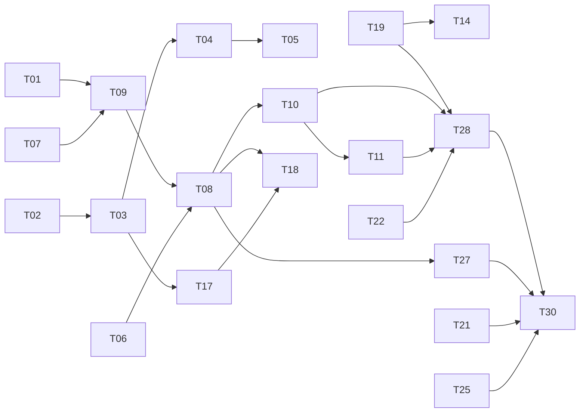

# Plano de ação

Base: `d8fdd89a7f980f7cf03736c6b83682cc517aaf15` · 29/10/2026 · **Somente planejamento**.

## Prioridades

P0 seria incidente explorável ou perda ativa de dados comprovada; nenhum P0 foi estabelecido por esta análise. P1 cobre confiabilidade, acessibilidade essencial, validações de segurança/capacidade e fundações do redesign. P2 cobre refinamento, manutenção e robustez adicional. P1 não significa que todas as tarefas precisem ser lançadas simultaneamente.

## Fases e critérios de saída

| Fase | Objetivo | Tarefas | Gate de saída |
|---|---|---|---|
| F0 — decisões e baseline | Validar jornadas, garantia de tela e dependências | T01, T21, T24 | Metas, ADR de tela e exceções reconciliadas |
| F1 — confiabilidade | Corrigir falhas e preparar operação | T02–T04, T06–T07, T14–T15, T19, T22–T23 | Reproduções fechadas, regressão e orçamento medido |
| F2 — experiência principal | Sistema visual, shell, chat, voz e performance | T05, T08–T11, T17–T18, T27 | Fluxos adaptativos acessíveis, mídia contínua, bundle comparado |
| F3 — features e manutenção | Música, jogos, perfil, dados e recovery | T12–T13, T16, T20, T25–T26, T29 | Contratos, restore e features sem regressões |
| F4 — validação e entrega | Capacidade, piloto e rollout | T28, T30 | Aceite técnico/humano e retorno ensaiado |

As fases são grupos de entrega, não barreiras rígidas. T09 pode começar após T01/T07; a refatoração T17 após T02/T03. Trabalho independente de documentação, triagem e scan pode avançar enquanto o design é validado. Não antecipar implementação de navegação sem preservar o controlador de mídia.

## Backlog completo

| Spec | Tarefa | Prioridade | Fase | Dias-pessoa | Depende de |
|---|---|---|---|---|---|
| [T01](specs/T01.md) | Validar jornadas e estabelecer a linha de base | P1 | F0 | 2–3 | — |
| [T02](specs/T02.md) | Separar autenticação, indisponibilidade e erros de API | P1 | F1 | 2–4 | — |
| [T03](specs/T03.md) | Tornar a recuperação do chat resistente a lacunas | P1 | F1 | 3–5 | T02 |
| [T04](specs/T04.md) | Especificar envio, falha e rascunho do chat | P1 | F1 | 2–4 | T02 T03 |
| [T05](specs/T05.md) | Preservar posição do histórico e destacar novas mensagens | P2 | F2 | 2–4 | T03 T04 |
| [T06](specs/T06.md) | Corrigir foco e fechamento do menu mobile | P1 | F1 | 2–3 | — |
| [T07](specs/T07.md) | Garantir contraste nas cores personalizadas | P1 | F1 | 2–4 | — |
| [T08](specs/T08.md) | Criar navegação adaptativa e shell simplificado | P1 | F2 | 4–7 | T01 T06 T09 |
| [T09](specs/T09.md) | Definir sistema visual e componentes compartilhados | P1 | F2 | 3–5 | T01 T07 |
| [T10](specs/T10.md) | Reorganizar entrada na voz e controles persistentes | P1 | F2 | 3–5 | T02 T08 T09 |
| [T11](specs/T11.md) | Projetar transmissão, layouts prontos e janelas externas | P1 | F2 | 3–5 | T08 T10 |
| [T12](specs/T12.md) | Melhorar busca, fila e feedback de música | P2 | F3 | 2–4 | T08 T09 T19 |
| [T13](specs/T13.md) | Unificar lobby e estados dos jogos | P2 | F3 | 3–5 | T08 T09 T19 |
| [T14](specs/T14.md) | Validar latência e justiça temporal do Beat Club | P1 | F1 | 3–5 | T19 |
| [T15](specs/T15.md) | Corrigir consistência e cobertura da agenda | P1 | F1 | 2–4 | T02 |
| [T16](specs/T16.md) | Melhorar perfil, MFA e reautenticação contextual | P2 | F3 | 2–4 | T02 T09 |
| [T17](specs/T17.md) | Dividir responsabilidades e habilitar regras de hooks | P2 | F2 | 3–5 | T02 T03 |
| [T18](specs/T18.md) | Reduzir carregamento inicial e trabalho de renderização | P1 | F2 | 3–5 | T08 T17 |
| [T19](specs/T19.md) | Compatibilizar polling e limites com uso simultâneo | P1 | F1 | 3–5 | — |
| [T20](specs/T20.md) | Validar e normalizar avatares no servidor | P2 | F3 | 2–3 | — |
| [T21](specs/T21.md) | Fechar decisão sobre exclusividade adversarial de tela | P1 | F0 | 2–4 | — |
| [T22](specs/T22.md) | Classificar erros e acrescentar observabilidade mínima | P1 | F1 | 2–4 | T02 |
| [T23](specs/T23.md) | Cobrir bot de música e dependências no gate de segurança | P1 | F1 | 2–3 | — |
| [T24](specs/T24.md) | Reconciliar exceções e versões efetivamente resolvidas | P1 | F0 | 1–2 | — |
| [T25](specs/T25.md) | Tornar recuperação completa e ensaiável | P2 | F3 | 2–4 | T24 |
| [T26](specs/T26.md) | Formalizar contratos, migrações e crescimento de dados | P2 | F3 | 2–4 | T24 |
| [T27](specs/T27.md) | Estabelecer gates de acessibilidade e regressão visual | P1 | F2 | 3–5 | T06 T07 T08 |
| [T28](specs/T28.md) | Validar capacidade e compatibilidade reais | P1 | F4 | 3–6 | T10 T11 T19 T22 |
| [T29](specs/T29.md) | Consolidar documentação e nomes públicos | P2 | F3 | 1–3 | T01 T15 T24 T26 |
| [T30](specs/T30.md) | Planejar rollout gradual e aceite final | P1 | F4 | 2–3 | T05 T12 T13 T14 T15 T16 T18 T20 T21 T23 T25 T26 T27 T28 T29 |

## Caminho de dependências

O diagrama mostra o caminho principal; a tabela/specs é a autoridade para todas as dependências.

## Esforço, equipe e cronograma indicativo

Soma das tarefas: **71–127 dias-pessoa**, incluindo desenvolvimento e validação por tarefa. Isso não é prazo de calendário. Somar cerca de 20% de contingência para descoberta, integração e correções de piloto; arredondar e reestimar após F0/F1. O spike T21 não inclui um eventual fork/patch de SFU: se necessário, seu esforço deve ser orçado separadamente antes de prometer entrega.

Para planejamento de capacidade: dois desenvolvedores com apoio de design e QA podem organizar aproximadamente 8–14 semanas, dependendo da dedicação efetiva e da espera por testes com usuários/hardware. Um único desenvolvedor levará mais. Não há datas de entrega assumidas nem tarefas atribuídas a pessoas reais.

| Janela indicativa | Foco | Entrega revisável |
|---|---|---|
| Semanas 1–2 | F0 e primeiras correções F1 | Relatório reproduzível, tokens e fluxos definidos |
| Semanas 3–5 | Fechar F1, shell e componentes | Beta de conversa/voz com navegação nova |
| Semanas 6–9 | Features, performance e recuperação | Release candidate com regressão e restore |
| Semanas 10–14, se necessário | Dispositivos, WAN, carga e piloto | Aceite e decisão de rollout |

## Gates comuns a toda implementação futura

- PR pequeno com requisito e evidência por SHA; nenhuma supressão de teste para obter aprovação.
- Manter português, limite de 16 conexões e uma tela autorizada; servidor é autoridade de mensagens/Coins/agenda.
- Não reescrever migrações aplicadas; testes destrutivos somente em banco descartável.
- Não enfraquecer CSRF/MFA/CSP, admissão, isolamento de redes ou restrições de mídia do navegador.
- Para UI: teclado, nomes acessíveis, foco, erro/loading/vazio/sucesso, mobile, redução de movimento e continuidade de áudio.
- Para release: revisar relatório de bugs P1, evidência de recuperação e limitação adversarial de tela; documentar qualquer decisão de escopo.

## Decisões ainda abertas, com padrão proposto

| Decisão | Padrão para planejar | Quem valida / quando |
|---|---|---|
| Nome do produto | Manter marca existente até estudo; unificar depois | Produto, T01 |
| Nome do calendário | Agenda; rota /outlook preservada | Produto, T01/T15 |
| Layout avançado | Dockview opt-in, preservando v4 | UX/engenharia, T08 |
| Tema | Escuro primeiro; claro só se demanda validada | UX, T01/T09 |
| Rascunho | Em memória por conta, limpar no logout | Produto/segurança, T04 |
| Exclusividade estrita | Não prometer zero sobreposição sem enforcement | Responsável técnico, T21 |
| Recovery | RPO 24h/RTO 60min como metas iniciais a medir | Operação, T25 |
| Retenção | Não apagar dados automaticamente | Produto/operador, T26 |

Essas decisões não bloqueiam a entrega deste planejamento. São pontos de validação na execução futura, não pedidos de autorização implícitos para alterar produção.
